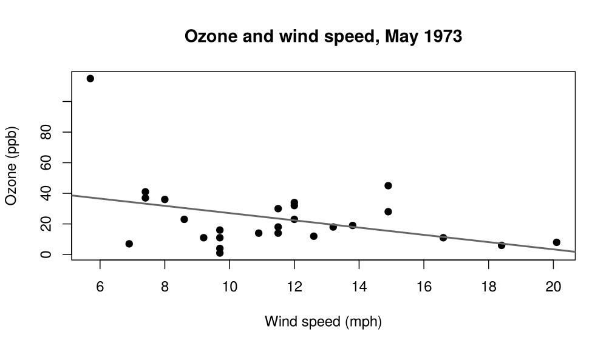
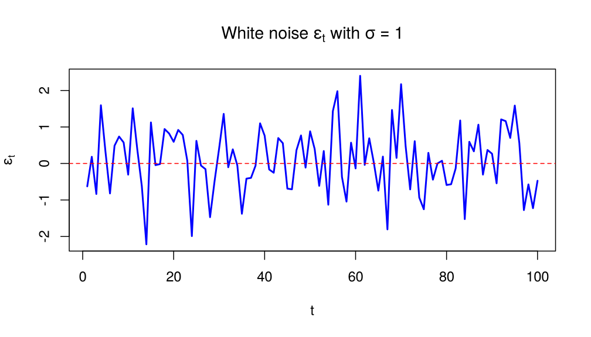
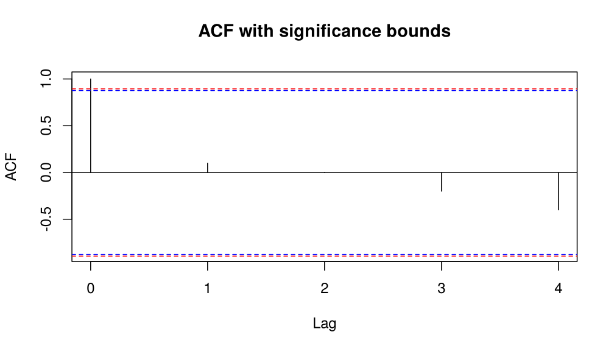
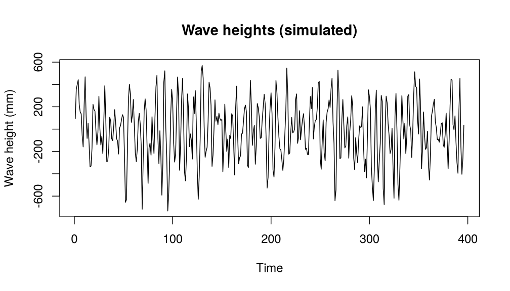
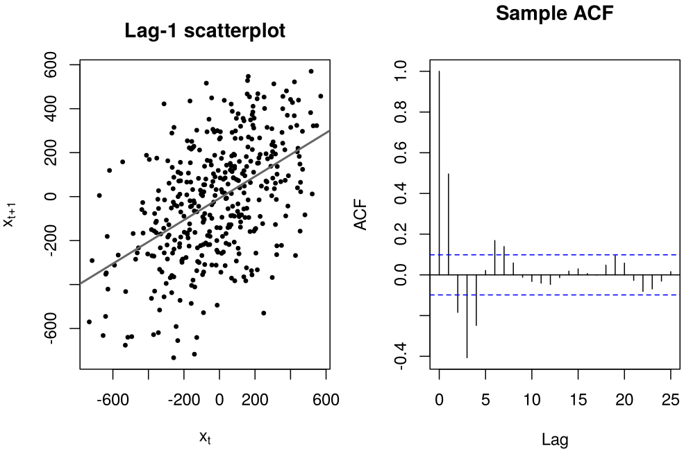
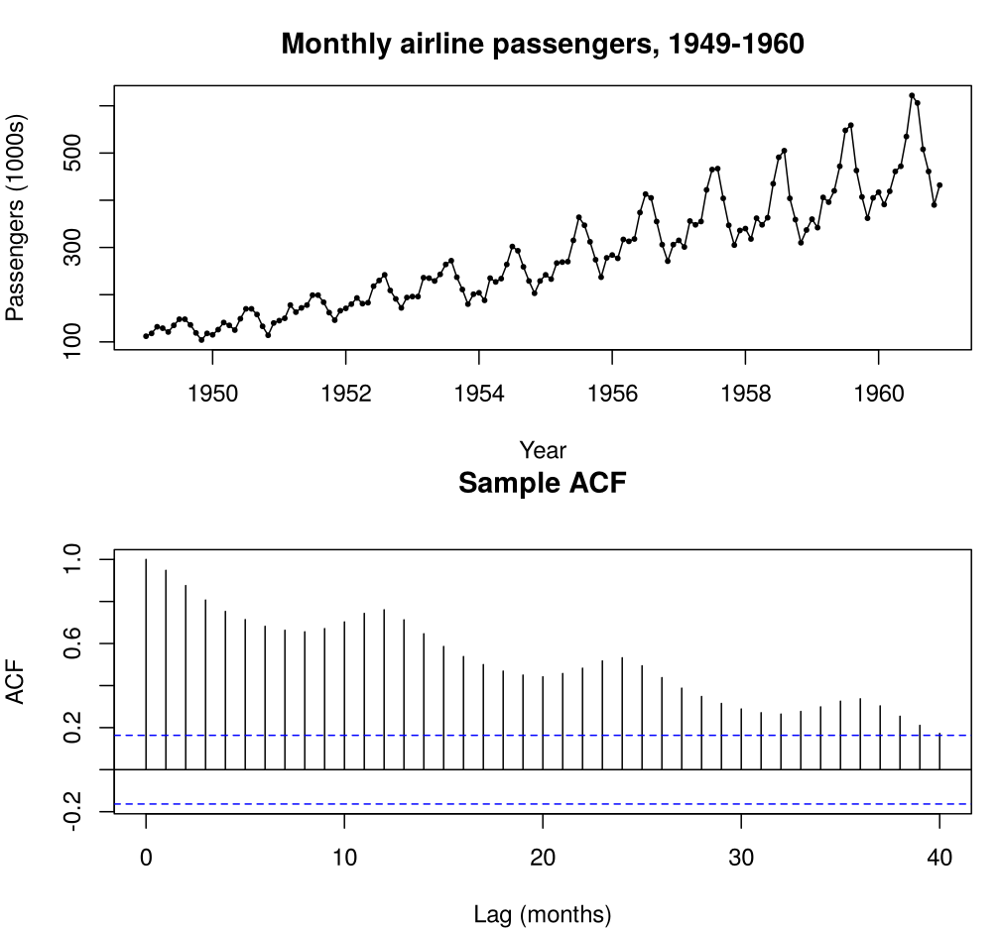
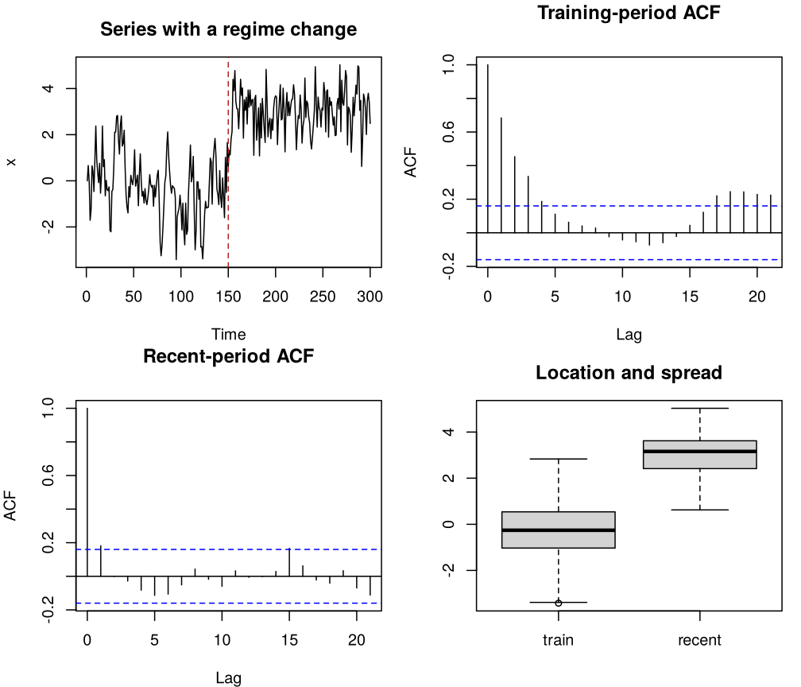

# Chapter 2: Fundamental Concepts

- [In-class R demo](https://watthanan-jat.github.io/SCIM311-Statistical-Modelling/demos/chapter02_in-class_demo.html)

## 1. Moments in time

A sequence of random variables $\lbrace X_t : t = 0, \pm 1, \pm 2, \dots \rbrace$
is called a stochastic process. It serves as a model for an observed time
series.

> **Definition (Stochastic process).** A *stochastic process* is a collection
> of random variables $\lbrace X_t : t \in T \rbrace$ indexed by time $t$.

In this course the index set $T$ is discrete (days, months, years, ...). Each
$X_t$ is a random quantity observed at time $t$, and an *observed time series*
$x_1, \dots, x_n$ is a single realisation of the process.

> **Remark.** The full probabilistic structure of a time series is determined
> by all the joint distributions of $(X_{t_1}, \dots, X_{t_k})$, for every $k$
> and every choice of times $t_1, \dots, t_k$.

Fortunately, we will not have to work explicitly with these multivariate
distributions. In practice we summarise the behaviour of the process by its
first two moments: the **means**, **variances** and **covariances**.

### 1.1 Recap: expectation, variance, covariance and correlation

**Expectation.** For a random variable $X$ with probability density function
$f(x)$, the **expected value** of $X$ is

```math
\text{E}(X) = \int_{-\infty}^{\infty} x f(x)\,dx .
```

For a function $h(X)$,

```math
\text{E}[h(X)] = \int_{-\infty}^{\infty} h(x) f(x)\,dx ,
```

and for a pair $(X, Y)$ with joint density $f(x, y)$,

```math
\text{E}[h(X, Y)] = \int_{-\infty}^{\infty}\!\int_{-\infty}^{\infty} h(x, y) f(x, y)\,dx\,dy .
```

For discrete random variables the integrals are replaced by sums. The **mean**
of $X$ is denoted $\mu_X = \text{E}(X)$.

**Variance.** The **variance** of $X$ is

```math
\text{Var}(X) = \text{E}\big[(X - \text{E}(X))^2\big] = \text{E}(X^2) - [\text{E}(X)]^2 .
```

It measures the spread of $X$ about its mean. The standard deviation is
$\sigma_X = \sqrt{\text{Var}(X)}$.

> **Key properties (Variance).** For constants $a$ and $c$:
>
> 1. $\text{Var}(X) \ge 0$, and $\text{Var}(X) = 0$ if and only if $X$ is
>    constant (almost surely).
> 2. Shift invariance: $\text{Var}(X + c) = \text{Var}(X)$.
> 3. Scaling: $\text{Var}(aX) = a^2\,\text{Var}(X)$.
> 4. Sum formula: for any $X$ and $Y$,
>
> ```math
> \text{Var}(X + Y) = \text{Var}(X) + \text{Var}(Y) + 2\,\text{Cov}(X, Y),
> ```
>
> so that $\text{Var}(X + Y) = \text{Var}(X) + \text{Var}(Y)$ when $X$ and $Y$
> are independent.

**Covariance.** The **covariance** between $X$ and $Y$ is

```math
\text{Cov}(X, Y) = \text{E}\big[(X - \text{E}(X))(Y - \text{E}(Y))\big] = \text{E}(XY) - \text{E}(X)\,\text{E}(Y) .
```

Its sign gives the direction of the *linear* association between $X$ and $Y$.

> **Key properties (Covariance).** For constants $a$, $b$, $c$ and $d$:
>
> 1. Symmetry: $\text{Cov}(X, Y) = \text{Cov}(Y, X)$.
> 2. Variance as a special case: $\text{Cov}(X, X) = \text{Var}(X)$.
> 3. Bilinearity:
>    $\text{Cov}(aX + bY, Z) = a\,\text{Cov}(X, Z) + b\,\text{Cov}(Y, Z)$, and
>    similarly in the second argument.
> 4. Independence: if $X$ and $Y$ are independent, then
>    $\text{Cov}(X, Y) = 0$. The converse is not true in general.
> 5. Shift invariance: $\text{Cov}(X + c, Y + d) = \text{Cov}(X, Y)$.

**Correlation.** The (Pearson) **correlation coefficient** is the normalised
covariance

```math
\text{Corr}(X, Y) = \rho_{XY} = \frac{\text{Cov}(X, Y)}{\sqrt{\text{Var}(X)\,\text{Var}(Y)}} .
```

It measures the *strength and direction* of the linear association between $X$
and $Y$, and $-1 \le \rho_{XY} \le 1$.

> **Key properties (Correlation).**
>
> 1. Perfect correlation: $\rho_{XY} = 1$ if $Y = aX + b$ with $a > 0$, and
>    $\rho_{XY} = -1$ if $Y = aX + b$ with $a < 0$.
> 2. Zero correlation: $\rho_{XY} = 0$ means no *linear* relationship; $X$ and
>    $Y$ may still be dependent in a nonlinear way.
> 3. Linear transformations: for $a, c \neq 0$,
>
> ```math
> \rho_{aX + b,\, cY + d} = \text{sign}(ac)\,\rho_{XY} .
> ```

These properties are the tools we use below to work with the autocovariance and
autocorrelation functions.

<!-- box: rexample -->
**R example: Ozone and wind speed in New York**

The built-in data frame `airquality` contains daily air-quality measurements
in New York, May to September 1973. We use the 26 days of May with both
values recorded: mean ozone concentration (ppb, measured on Roosevelt Island)
and average wind speed (mph, at LaGuardia Airport). Ozone is a secondary
pollutant formed in sunlight from traffic and industrial emissions; wind
disperses it.


```r
may <- na.omit(airquality[airquality$Month == 5, c("Day", "Ozone", "Wind")])
nrow(may)      # 26 complete days
```

```
#> [1] 26
```

```r
head(may, 8)
```

```
#>   Day Ozone Wind
#> 1   1    41  7.4
#> 2   2    36  8.0
#> 3   3    12 12.6
#> 4   4    18 11.5
#> 6   6    28 14.9
#> 7   7    23  8.6
#> 8   8    19 13.8
#> 9   9     8 20.1
```


```r
summary(may[, c("Ozone", "Wind")])
```

```
#>      Ozone             Wind       
#>  Min.   :  1.00   Min.   : 5.700  
#>  1st Qu.: 11.00   1st Qu.: 9.325  
#>  Median : 18.00   Median :11.500  
#>  Mean   : 23.62   Mean   :11.458  
#>  3rd Qu.: 31.50   3rd Qu.:13.050  
#>  Max.   :115.00   Max.   :20.100
```

```r
cov(may$Ozone, may$Wind)
```

```
#> [1] -29.22092
```

```r
cor(may$Ozone, may$Wind)
```

```
#> [1] -0.3742975
```


```r
plot(may$Wind, may$Ozone, pch = 19,
     main = "Ozone and wind speed, May 1973",
     xlab = "Wind speed (mph)", ylab = "Ozone (ppb)")
abline(lm(Ozone ~ Wind, data = may), col = "grey40", lwd = 2)
```



*Figure 2.1. Daily ozone concentration against wind speed, New York, May 1973 (26 complete days).*

The sample covariance is negative, and the sample correlation,
$r = -0.374$, shows a moderate negative linear
association: windier days tend to have less ozone. The scatterplot shows that
the relation is far from exact and that a single calm day with very high ozone
has a large influence on $r$. Note that `cov()`, `var()` and `sd()` in R use
the divisor $n - 1$; the correlation does not depend on the divisor.
<!-- /box -->

### 1.2 Mean, variance and covariance in time

> **Definition (Population moments).** For a time series
> $\lbrace X_t : t \in T \rbrace$, the **mean function** is
>
> ```math
> \mu_t = \text{E}(X_t),
> ```
>
> the expected value of the process at time $t$. The **autocovariance
> function** is the covariance of the process with itself at two times,
>
> ```math
> \gamma_{s,t} = \text{Cov}(X_s, X_t) \quad \text{for all } s, t,
> ```
>
> so that $\sigma_t^2 = \text{Var}(X_t) = \gamma_{t,t}$. The
> **autocorrelation function** is
>
> ```math
> \rho_{s,t} = \text{Corr}(X_s, X_t) = \frac{\gamma_{s,t}}{\sqrt{\gamma_{s,s}\,\gamma_{t,t}}},
> ```
>
> provided that $\sigma_s, \sigma_t > 0$.

The process is *autocorrelated* if $\rho_{t,t+h} \neq 0$ for at least one lag
$h \neq 0$; its values are then not independent. With data, we judge this by
whether a sample autocorrelation is significantly different from zero (see "Testing sample autocorrelations" below).

> **Definition (White noise).** A process $\lbrace \epsilon_t : t = 0, 1, 2, \dots \rbrace$
> is called *white noise*, written $\epsilon_t \sim \text{WN}(0, \sigma^2)$, if
> the $\epsilon_t$ are uncorrelated with $\text{E}(\epsilon_t) = 0$ and
> $\text{Var}(\epsilon_t) = \sigma^2$, where $\sigma^2$ is a constant. If, in
> addition, the $\epsilon_t$ are independent and identically distributed, the
> process is *iid white noise* (or *iid noise*); if they are iid
> $N(0, \sigma^2)$, it is *Gaussian white noise*.

Cryer and Chan (2008) define white noise as iid; Brockwell and Davis (2002)
and Shumway and Stoffer (2017) require only uncorrelated terms, and these notes
follow the latter. The moment calculations in this chapter need only white
noise, while the bounds for the sample ACF in Section 2.4 assume iid white
noise.

<!-- box: rexample -->
**R example: Simulated white noise**


```r
set.seed(1)
n <- 100                 # number of observations
s <- 1                   # standard deviation
wn <- rnorm(n, mean = 0, sd = s)
plot.ts(wn, main = expression("White noise" ~ epsilon[t] ~ "with" ~ sigma == 1),
        ylab = expression(epsilon[t]), xlab = "t", col = "blue", lwd = 2)
abline(h = 0, col = "red", lty = 2)
```



*Figure 2.2. Simulated Gaussian white noise with sigma = 1.*
<!-- /box -->

> **Question.** Compute $\gamma_{s,t}$ and $\rho_{s,t}$ for white noise.


## 2. Stationarity

To make statistical inferences about the structure of a stochastic process from
an observed record of that process, we must usually make some simplifying and
(presumably) reasonable assumptions about that structure. The most important
such assumption is **stationarity**. The basic idea is that the probability laws
that govern the behaviour of the process *do not change over time*: in a sense,
the process is in statistical equilibrium.

### 2.1 Strict and weak stationarity

> **Definition (Strict stationarity).** A process $\lbrace X_t \rbrace$ is
> **strictly stationary** if, for every $n \ge 1$, all times
> $t_1, \dots, t_n$ and every integer shift $h$,
>
> ```math
> (X_{t_1}, \dots, X_{t_n}) \stackrel{d}{=} (X_{t_1 + h}, \dots, X_{t_n + h}),
> ```
>
> where $\stackrel{d}{=}$ means equality of the joint distributions.

- The joint distribution of any $n$ values of the process is the same as the
  joint distribution of the $n$ values shifted by $h$ time units, wherever the
  time origin is placed.
- The probabilistic structure of a strictly stationary process is invariant
  under a shift in time.
- The terms *strongly stationary* and *completely stationary* are also used.

The definition of strict stationarity above is too strong for most
applications, and it is difficult to assess from a single data set. Rather than
imposing conditions on all the joint distributions of a time series, we use a
milder version that imposes conditions only on the first two moments. The
variables may still be correlated, but the process is called *second-order* (or
weakly) stationary if its mean and variance are constant and the correlation
depends only on the number of time steps separating the observations, known as
the *lag*.

> **Definition (Weak stationarity).** A process $\lbrace X_t \rbrace$ is
> **weakly stationary** if
>
> 1. $\text{E}(X_t) = \mu$ for all $t$, with $\mu$ finite (constant mean);
> 2. $\text{Var}(X_t) = \sigma^2 < \infty$ for all $t$ (constant variance);
> 3. $\text{Cov}(X_t, X_{t+h}) = \gamma_h$ depends only on the lag $h$, not on
>    $t$.

> **Key idea.** If $\lbrace X_t \rbrace$ is strictly stationary and
> $\text{E}(X_t^2) < \infty$, then it is weakly stationary. The converse is
> false in general, but it holds for Gaussian processes, whose joint
> distributions are determined by their means and covariances.

From now on, *stationary* means weakly stationary; when we need the strict
sense we say *strictly stationary*.

> **Definition (ACVF and ACF).** For a stationary process $\lbrace X_t \rbrace$
> with mean $\mu$, the **autocovariance function (ACVF) at lag $h$** is
>
> ```math
> \gamma_h = \text{Cov}(X_{t+h}, X_t) = \text{E}\big[(X_{t+h} - \mu)(X_t - \mu)\big],
> ```
>
> and the **autocorrelation function (ACF) at lag $h$** is
>
> ```math
> \rho_h = \frac{\gamma_h}{\gamma_0}, \qquad \text{so that } \rho_0 = 1 .
> ```
>
> The ACF is the correlation between values $h$ periods apart.

> **Key properties (Autocovariance function).**
>
> 1. $\gamma_0 = \text{Var}(X_t) \ge 0$.
> 2. $|\gamma_h| \le \gamma_0$ for all $h$.
> 3. $\gamma_h = \gamma_{-h}$ for all $h$.

> **Key properties (Autocorrelation function).**
>
> 1. $\rho_0 = 1$.
> 2. $|\rho_h| \le 1$ for all $h$.
> 3. $\rho_h = \rho_{-h}$ for all $h$.

<!-- box: example -->
**Example: Are white noise and the random walk stationary?**

The random walk is the process

```math
X_t = X_{t-1} + \epsilon_t, \qquad t = 1, 2, \dots, \qquad X_0 = 0,
```

where $\lbrace \epsilon_t \rbrace$ is white noise with variance $\sigma^2$.

1. Is the white noise process stationary?
2. Is the random walk stationary?
<!-- /box -->


### 2.2 Estimating the mean and the autocorrelation

In theory, autocorrelation describes the underlying properties of a time series
model. In practice we only have sampled data $x_1, x_2, \dots, x_n$, which
limits what can be estimated. Unlike classical statistics, where several
independent copies of a variable are often available, time series analysis
usually has just one realisation of the process. This makes the assumption of
*stationarity* crucial: it allows us to treat averages computed from a single
realisation as estimates of the mean and covariance functions of the
population. In particular, if a time series is stationary, its mean function
$\mu_t = \mu$ is constant, and we can estimate it by the *sample mean*.

> **Definition (Sample moments).** Given observations $x_1, \dots, x_n$, the
> **sample mean** is
>
> ```math
> \bar{x} = \frac{1}{n} \sum_{t=1}^{n} x_t ,
> ```
>
> and the **sample variance** is
>
> ```math
> s^2 = \frac{1}{n} \sum_{t=1}^{n} (x_t - \bar{x})^2 .
> ```

The divisor of the sample variance is $n$ rather than the more familiar $n - 1$.
This is the usual convention in time series analysis, and because $n$ is usually
not small there is little difference between the two. (R's `var()` uses
$n - 1$; `acf()` uses $n$.)

**Variance of the sample mean.** For a stationary process the sample mean
$\bar X = n^{-1}\sum_{t=1}^n X_t$ is unbiased for $\mu$, but its precision
depends on the autocorrelation. Since $\text{Cov}(X_s, X_t) = \gamma_{t-s}$ and
exactly $n - |h|$ pairs $(s, t)$ in $\lbrace 1, \dots, n\rbrace^2$ have
$t - s = h$,

```math
\text{Var}(\bar X)
= \frac{1}{n^2}\sum_{s=1}^{n}\sum_{t=1}^{n}\gamma_{t-s}
= \frac{1}{n^2}\sum_{h=-(n-1)}^{n-1}(n - |h|)\,\gamma_h
= \frac{\gamma_0}{n}\Big[1 + 2\sum_{h=1}^{n-1}\Big(1 - \frac{h}{n}\Big)\rho_h\Big].
```

If $\sum_h |\rho_h| < \infty$, dominated convergence gives, for large $n$,

```math
\text{Var}(\bar X) \approx \frac{\gamma_0}{n}\sum_{h=-\infty}^{\infty}\rho_h
= \frac{\gamma_0}{n}\Big(1 + 2\sum_{h=1}^{\infty}\rho_h\Big).
```

The factor $\gamma_0/n$ is the familiar result for independent observations.
Positive autocorrelation inflates it: neighbouring values carry overlapping
information, so the sample is worth fewer "effective" independent
observations, about $n/\sum_h\rho_h$. Negative autocorrelation makes the mean
easier to estimate, because the series keeps crossing its mean.

- If $\rho_h = \phi^{|h|}$ with $|\phi| < 1$ (the AR(1) model of Chapter 4),
  summing the geometric series gives
  $\text{Var}(\bar X) \approx \dfrac{1 + \phi}{1 - \phi}\,\dfrac{\gamma_0}{n}$;
  for $\phi = 0.7$ the factor is $5.67$.
- If $X_t = \mu + \epsilon_t - 0.5\,\epsilon_{t-1}$, then $\rho_1 = -0.4$ and
  $\rho_h = 0$ for $h \ge 2$ (Chapter 3), so
  $\text{Var}(\bar X) = \dfrac{\gamma_0}{n}\big[1 - 0.8\,(1 - 1/n)\big]
  \approx 0.2\,\dfrac{\gamma_0}{n}$.
- Without stationarity the picture changes completely. If $X_t = \mu + W_t$,
  where $W_t = W_{t-1} + \epsilon_t$, $W_0 = 0$, is the random walk of the
  example above, then $\sum_{t=1}^n W_t = \sum_{j=1}^n (n - j + 1)\epsilon_j$ and
  $\text{Var}(\bar X) = \sigma^2(n+1)(2n+1)/(6n)$, which *grows* with $n$:
  more data do not help.

<!-- box: rexample -->
**R example: Checking the variance of the sample mean**

We simulate 2000 independent AR(1) series with $\phi = 0.7$ and $n = 100$
($\gamma_0 = 1/(1 - \phi^2)$ for unit noise variance) and compare the
empirical variance of their sample means with the exact formula, the
large-$n$ approximation and the naive value $\gamma_0/n$.


```r
set.seed(22)
phi <- 0.7; n <- 100; nsim <- 2000       # n = sample size
eps <- matrix(rnorm((n + 100) * nsim), ncol = nsim)
x <- filter(eps, phi, method = "recursive")[-(1:100), ]  # burn-in dropped
xbar <- colMeans(x)

gamma0 <- 1 / (1 - phi^2)
h <- 1:(n - 1)
round(c(simulated = var(xbar),
        exact = gamma0 / n * (1 + 2 * sum((1 - h / n) * phi^h)),
        approx = gamma0 / n * (1 + phi) / (1 - phi),
        naive = gamma0 / n), 4)
```

```
#> simulated     exact    approx     naive 
#>    0.1040    0.1081    0.1111    0.0196
```

The simulated variance agrees with the formula up to Monte Carlo error and is
more than five times the naive value $\gamma_0/n$.
<!-- /box -->

> **Question.** A stationary series has $\rho_1 = 0.4$ and $\rho_h = 0$ for
> $h \ge 2$. For $n = 100$, compare $\text{Var}(\bar X)$ with $\gamma_0/n$. How
> many independent observations is the sample worth for estimating $\mu$?


> **Further reading.** Cryer and Chan (2008), Section 3.2; Brockwell and Davis
> (2002), Section 2.4.1.

> **Definition (Sample ACVF and ACF).** For time series data
> $x_1, \dots, x_n$, the **sample autocovariance function** is
>
> ```math
> \hat{\gamma}_h = \frac{1}{n} \sum_{t=1}^{n-h} (x_{t+h} - \bar{x})(x_t - \bar{x}), \qquad h = 0, 1, \dots, n - 1,
> ```
>
> and the **sample autocorrelation function** is
>
> ```math
> \hat{\rho}_h = \frac{\hat{\gamma}_h}{\hat{\gamma}_0}, \qquad h = 0, 1, \dots, n - 1 .
> ```

The sum runs over a restricted range because $x_{t+h}$ is not available for
$t + h > n$. The divisor is $n$, not $n - h$, for every lag. Note also that
$\hat{\gamma}_0 = s^2$.

> **Rule of thumb.** At least 50 observations are needed to give a reliable
> estimate of the ACF, and the sample autocorrelations should be calculated up
> to lag $H$, where $H$ is about $n/4$.

### 2.3 Worked calculation: what does the ACF measure?

The ACF compares the series with a shifted copy of itself. At lag $1$ we compare
neighbouring values; at lag $2$, values two time periods apart. If high values
tend to be followed by high values, the ACF is positive. If high values tend to
be followed by low values, it is negative. If there is no clear linear
relationship, it is close to zero.

<!-- box: example -->
**Example: The sample ACF of five observations**

Consider $x = (4, 5, 6, 5, 4)$. The mean is

```math
\bar{x} = \frac{4 + 5 + 6 + 5 + 4}{5} = 4.8,
```

and the deviations from the mean are

| $t$ | $x_t$ | $x_t - \bar{x}$ |
| --- | ---: | ---: |
| 1 | 4 | $-0.8$ |
| 2 | 5 | $0.2$ |
| 3 | 6 | $1.2$ |
| 4 | 5 | $0.2$ |
| 5 | 4 | $-0.8$ |

Lag $0$ measures the variation of the series around its mean:

```math
\hat{\gamma}_0 = \frac{0.64 + 0.04 + 1.44 + 0.04 + 0.64}{5} = 0.56 .
```

Lag $1$ multiplies each deviation by the previous one:

```math
\hat{\gamma}_1 = \frac{(0.2)(-0.8) + (1.2)(0.2) + (0.2)(1.2) + (-0.8)(0.2)}{5} = 0.032,
```

so $\hat{\rho}_1 = 0.032/0.56 \approx 0.057$.

This is close to zero: neighbouring observations show no strong linear memory in
this tiny example. Lag $2$ compares values two periods apart:

```math
\hat{\gamma}_2 = \frac{(1.2)(-0.8) + (0.2)(0.2) + (-0.8)(1.2)}{5} = -0.376,
```

so $\hat{\rho}_2 = -0.376/0.56 \approx -0.671$.

The negative value means that observations two periods apart tend to move in
opposite directions in this short sequence. R gives the same values:


```r
round(acf(c(4, 5, 6, 5, 4), plot = FALSE)$acf[1:3], 3)
```

```
#> [1]  1.000  0.057 -0.671
```
<!-- /box -->

**Try this.** Before calculating, predict the sign of the lag-$1$ sample
ACF for each series.

| Series | Pattern | Predicted lag-1 ACF |
| --- | --- | --- |
| $(2, 3, 4, 5, 6)$ | steadily increasing | positive / negative / near zero |
| $(2, 6, 2, 6, 2)$ | alternating high and low | positive / negative / near zero |
| $(3, 3, 3, 3, 3)$ | no variation | can we define it? |


The key point is the interpretation, not the arithmetic: the ACF is a numerical
summary of memory.

<!-- box: example -->
**Example: A short series to compute by hand**

Consider the short series below.

1. Complete the column of deviations from the mean.
2. Compute the sample autocovariances $\hat{\gamma}_0$, $\hat{\gamma}_1$ and
   $\hat{\gamma}_2$, and the sample autocorrelations $\hat{\rho}_1$ and
   $\hat{\rho}_2$.

| $t$ | $x_t$ | $x_t - \bar{x}$ |
| --- | --- | --- |
| 1 | 2 | |
| 2 | 4 | |
| 3 | 3 | |
| 4 | 5 | |
| 5 | 6 | |
<!-- /box -->


### 2.4 Testing sample autocorrelations

The first question about a series is often whether it could be iid white
noise. We answer it by comparing each sample autocorrelation $\hat{\rho}_h$
with its standard error under that hypothesis. If $\lbrace X_t \rbrace$ is iid
white noise with finite variance,
then for large $n$ and each fixed lag $h \ge 1$, $\hat{\rho}_h$ is approximately
normal with mean $0$ and variance

```math
\text{Var}(\hat{\rho}_h) \approx \frac{1}{n} .
```

**Test of significance.** Under $H_0$: the series is iid white noise (so
$\rho_h = 0$ for all $h > 0$), at level $\alpha = 0.05$,

```math
\hat{\rho}_h \approx N\!\left(0, \frac{1}{n}\right)
\quad \Longrightarrow \quad
\text{95\% bounds} \;\; \pm \frac{1.96}{\sqrt{n}} .
```

**Reading the ACF plot.**

- The x-axis gives the lag $h$ and the y-axis the sample autocorrelation
  $\hat{\rho}_h$ at that lag.
- The lag-$0$ autocorrelation is always $1$.
- The dashed lines drawn by `acf()` are at $\pm 1.96/\sqrt{n}$, often
  approximated by $\pm 2/\sqrt{n}$.
- If $\hat{\rho}_h$ falls outside these lines, we have evidence at the 5% level
  against the hypothesis that the series is iid white noise. The bounds do *not*
  test $\rho_h = 0$ for a general process: when other autocorrelations are
  nonzero, the standard error of $\hat\rho_h$ is different (see Bartlett's
  formula below).

When many lags are inspected, about one in twenty of them is expected to fall
outside the bounds even for iid white noise, so a single marginal spike at a
large lag is weak evidence.

<!-- box: rexample -->
**R example: ACF plot with significance bounds**

We use the five observations $(2, 4, 3, 5, 6)$ of the previous example. With
$n = 5$ the bounds are very wide; the code only shows the mechanics (the rule of
thumb asks for at least 50 observations).


```r
x <- c(2, 4, 3, 5, 6)
n <- length(x)

# 1. Compute and plot the ACF (blue lines: +/- 1.96/sqrt(n))
acf_result <- acf(x, main = "ACF with significance bounds")

# 2. Add the +/- 2/sqrt(n) lines
abline(h = c(-2, 2) / sqrt(n), col = "red", lty = 2)
```



*Figure 2.3. Sample ACF of the series (2, 4, 3, 5, 6) with the bounds 1.96/sqrt(n) (blue) and 2/sqrt(n) (red).*

```r
# 3. Print the ACF values (the first one is lag 0)
acf_values <- acf_result$acf[, , 1]
print(acf_values)

# 4. Which lags h >= 1 are significant?
sig_limit <- 2 / sqrt(n)
sig_lags <- which(abs(acf_values[-1]) > sig_limit)  # index = lag
cat("Significant lags at the 5% level:", sig_lags, "\n")
```

Run the code to check your answers to the previous example. No lag is
significant: with only five observations the bounds are
$\pm 2/\sqrt{5} = \pm 0.89$, and every sample
autocorrelation lies well inside them.
<!-- /box -->

<!-- box: rexample -->
**R example: Simulated wave heights**

Wave heights in a laboratory wave tank rise and fall in an irregular,
quasi-periodic way. We simulate $n = 396$ such readings, in mm, from a model of
the kind studied in Chapter 4 (an AR(2) process). Let $X_t$ denote the wave
height at time $t$.


```r
set.seed(311)
wave <- arima.sim(model = list(ar = c(0.8, -0.6)), n = 396, sd = 200)
wave <- round(wave)    # heights in mm
plot(wave, main = "Wave heights (simulated)",
     xlab = "Time", ylab = "Wave height (mm)")
```



*Figure 2.4. Simulated wave heights (mm), 396 readings.*


```r
n <- length(wave)
x_now <- wave[1:(n - 1)]
x_next <- wave[2:n]

par(mfrow = c(1, 2), mar = c(4, 4, 3, 1))
plot(x_now, x_next, pch = 19, cex = 0.5,
     main = "Lag-1 scatterplot",
     xlab = expression(x[t]), ylab = expression(x[t + 1]))
abline(lm(x_next ~ x_now), col = "grey40", lwd = 2)
acf(wave, lag.max = 25, main = "Sample ACF")
```



*Figure 2.5. Lag-1 scatterplot of the wave heights with the least-squares line (left) and their sample ACF (right).*

```r
par(mfrow = c(1, 1))

rho_wave <- acf(wave, lag.max = 25, plot = FALSE)$acf[-1]  # lags 1-25
round(rho_wave[1:8], 3)
```

```
#> [1]  0.496 -0.184 -0.407 -0.248  0.021  0.169  0.139  0.058
```

The lag-1 scatterplot slopes upwards: a high reading tends to be followed by
another high reading, and $\hat{\rho}_1 = 0.496$. The ACF
then becomes negative at lags 2 to 4, most strongly at lag
3 ($\hat{\rho}_3 = -0.407$),
when a crest tends to be followed by a trough. The oscillation dies out as the
lag increases. Several values lie well outside the bounds
$\pm 1.96/\sqrt{396} = \pm 0.0985$, so the series is
clearly not white noise: it has strong short-term memory, with the
wave-like pattern visible in the time plot.
<!-- /box -->

### 2.5 Bartlett's formula

For a process that is not iid white noise the variance of $\hat\rho_h$ is not
$1/n$, and the sample autocorrelations at different lags are correlated. The
general large-sample result is due to Bartlett.

> **Key properties (Bartlett's formula).** Let
> $X_t = \mu + \sum_{j\ge0}\psi_j\epsilon_{t-j}$ with $\epsilon_t$ iid,
> mean $0$ and finite variance, $\sum_j|\psi_j| < \infty$ and
> $\sum_j j\psi_j^2 < \infty$ (this covers the stationary ARMA models of
> Chapters 3 to 5). For fixed $k$ and large $n$,
> $(\hat\rho_1, \dots, \hat\rho_k)$ is approximately normal with mean
> $(\rho_1, \dots, \rho_k)$ and covariance matrix $W/n$, where
>
> ```math
> w_{ij} = \sum_{m=1}^{\infty}\big(\rho_{m+i} + \rho_{m-i} - 2\rho_i\rho_m\big)
>          \big(\rho_{m+j} + \rho_{m-j} - 2\rho_j\rho_m\big).
> ```
>
> In particular $\text{Var}(\hat\rho_h) \approx w_{hh}/n$ with
> $w_{hh} = \sum_{m\ge1}(\rho_{m+h} + \rho_{m-h} - 2\rho_h\rho_m)^2$.
>
> - **iid white noise:** $w_{ii} = 1$ and $w_{ij} = 0$ for $i \ne j$, so the
>   $\hat\rho_h$ are approximately independent $N(0, 1/n)$: the
>   $\pm 1.96/\sqrt{n}$ bounds.
> - **AR(1)**, $\rho_h = \phi^{|h|}$: for $m \ge 1$ the $m$-th term of
>   $w_{11}$ is $(\phi^{m+1} + \phi^{m-1} - 2\phi^{m+1})^2 = \phi^{2(m-1)}(1-\phi^2)^2$,
>   so $\text{Var}(\hat\rho_1) \approx (1 - \phi^2)/n$, smaller than $1/n$.

Two practical consequences follow. First, the bounds for a lag $h$ depend on
the autocorrelations at the other lags; Chapter 3 uses this to obtain wider
bounds for judging the cut-off of an MA($q$) model. Second, neighbouring sample
autocorrelations can be strongly correlated: for an AR(1) with $\phi = 0.7$,
$\text{Corr}(\hat\rho_1, \hat\rho_2) \approx 0.89$. Smooth "ripples" or
"waves" in a sample ACF therefore need not correspond to anything in the true
ACF.

> **Further reading.** Brockwell and Davis (2002), Section 2.4.2, equations
> (2.4.9) and (2.4.10); Cryer and Chan (2008), Section 6.1, equation (6.1.2).

### 2.6 The ACF as an indicator of nonstationarity

The sample autocovariance and autocorrelation functions can be computed for
*any* data set $x_1, \dots, x_n$; they are not restricted to observations from a
stationary time series. For data containing a trend, $\hat{\rho}_h$ starts
near $1$ and decays almost linearly as $h$ increases, and for data with a
substantial deterministic periodic component, $|\hat{\rho}_h|$ shows similar
behaviour with the same periodicity. Thus $\hat{\rho}_h$ is useful as an
indicator of nonstationarity. A stationary AR(1) with $\phi$ close to $1$ also
has an ACF that decays slowly (geometrically), and in a short series it can be
hard to tell apart from a random walk, which is why Chapter 7 introduces a
formal test (the augmented Dickey–Fuller test).

<!-- box: rexample -->
**R example: Airline passengers**

The built-in series `AirPassengers` (Chapter 1) gives the monthly totals of
international airline passengers, in thousands, from January 1949 to December
1960. It has an upward trend and a strong seasonal pattern of period 12 months.


```r
par(mfrow = c(2, 1), mar = c(4, 4, 3, 1))
plot(AirPassengers, type = "o", pch = 20, cex = 0.6,
     main = "Monthly airline passengers, 1949-1960",
     xlab = "Year", ylab = "Passengers (1000s)")
# as.numeric(): lags in months rather than in years
acf(as.numeric(AirPassengers), lag.max = 40,
    main = "Sample ACF", xlab = "Lag (months)")
```



*Figure 2.6. AirPassengers: time plot (top) and sample ACF up to lag 40 months (bottom).*

```r
par(mfrow = c(1, 1))
```

The sample ACF starts near 1 and decays almost linearly because of the trend,
and it has local peaks at lags 12, 24 and 36 because of the seasonality. It
does not look like the ACF of a stationary series with short memory.
<!-- /box -->

**Summary.** A stationary process has stable behaviour: its mean, variance and
dependence pattern stay the same over time. A nonstationary process shows
trends, changing spread, or correlation that persists and does not decay.

| ACF pattern | Interpretation |
| --- | --- |
| Spike only at lag 0 | White noise (no correlation) |
| Starts near 1, decays almost linearly | Trend or other nonstationarity |
| Alternating signs | Negative dependence between neighbours |
| Peaks at seasonal lags | Periodic (seasonal) correlation |

## Chapter checkpoint

Before moving on, make sure you can answer these questions in words.

1. What is the difference between variance and autocovariance?
2. What does the ACF measure at lag $h$?
3. Why is the lag-$0$ ACF always equal to $1$?
4. What does a sample ACF that starts near 1 and decays almost linearly
   suggest about stationarity?
5. Why is the sample mean of a positively autocorrelated series less precise
   than the mean of the same number of independent observations?

Try this: look at an ACF plot and describe it in plain language
first. Only then connect the description to technical terms such as white noise,
persistence, alternation or seasonality.


## Modern time-series thread 2: From stationarity to distribution shift

Stationarity describes stability **within a stochastic process**. Modern
predictive systems must also consider stability **between the data used for
training and the data encountered later**. When those distributions differ, we
say that the model faces **distribution shift**.

These ideas are related but not identical:

- A nonstationary series may have a changing mean, variance or dependence over
  time.
- Distribution shift means that the future deployment data do not follow the
  same distribution as the training data.
- A model may be fitted to a locally stationary training window and still fail
  after a policy change, equipment replacement, economic shock or new customer
  behaviour.

### Model idea: supervised windows and chronological validation

A common modern forecasting representation converts one series into
input-output windows. For a look-back length $L$ and forecast horizon $H$,

```math
\mathbf{z}_t = (X_{t-L+1}, \ldots, X_t),
\qquad
\mathbf{y}_t = (X_{t+1}, \ldots, X_{t+H}).
```

A model $g_\theta$ is trained so that

```math
\hat{\mathbf{y}}_t = g_\theta(\mathbf{z}_t).
```

The windows overlap, so they are not independent observations. Randomly
shuffling them before splitting can place nearly identical neighbouring windows
in both the training and the test set. A safer design preserves time order:

```
past -------------------------------> future
|       training       | validation |   test   |
```

Any centring or scaling constants must be estimated from the training period
only. Otherwise information from the future leaks into the model preparation.

### Detecting a shift before trusting a forecast

Suppose the training regime has mean $\mu_1$ and lag-1 correlation $\rho_1$,
while the deployment regime has $\mu_2$ and $\rho_2$. Useful comparisons are

```math
\Delta_\mu = \bar{X}_{\text{recent}} - \bar{X}_{\text{train}},
\qquad
\Delta_\rho = \hat{\rho}_{1,\text{recent}} - \hat{\rho}_{1,\text{train}} .
```

Large differences do not by themselves identify the cause, but they warn that a
model trained under the first regime may need recalibration or refitting.

### Use case: electricity demand after a change in operations

An electricity model is trained on a building that operates five days a week.
The building later switches to seven-day operation. The earlier ACF may show a
strong weekly cycle, yet the mean level and the weekend relationship have
changed. An accurate historical fit is not evidence that the model will remain
accurate after the change.

**Activity: two halves, two regimes.** The code simulates
a persistent series whose mean and dependence change at time 151. Analyse the
first and second halves separately.


```r
set.seed(311)
n <- 300
x <- numeric(n)
eps <- rnorm(n)

for (t in 2:150) {
  x[t] <- 0.75 * x[t - 1] + eps[t]
}
for (t in 151:n) {
  x[t] <- 3 + 0.25 * (x[t - 1] - 3) + eps[t]
}

train <- x[1:150]
recent <- x[151:300]

par(mfrow = c(2, 2), mar = c(4, 4, 3, 1))
plot.ts(x, main = "Series with a regime change")
abline(v = 150, col = "firebrick", lty = 2)
acf(train, main = "Training-period ACF")
acf(recent, main = "Recent-period ACF")
boxplot(train, recent, names = c("train", "recent"),
        main = "Location and spread")
```



*Figure 2.7. A simulated series whose mean and dependence change at time 151, with the ACF and boxplot of each half.*

```r
par(mfrow = c(1, 1))

c(train_mean = mean(train), recent_mean = mean(recent))
```

```
#>  train_mean recent_mean 
#>  -0.2431446   3.0363640
```

```r
c(train_rho1 = acf(train, plot = FALSE)$acf[2],
  recent_rho1 = acf(recent, plot = FALSE)$acf[2])
```

```
#>  train_rho1 recent_rho1 
#>   0.6840437   0.1818061
```

Questions:

1. Is either segment approximately stationary on its own?
2. Would a model estimated on the first segment transfer unchanged to the
   second?
3. Why would a random train/test split conceal part of the problem?
4. What operational response is reasonable: transform, use a shorter training
   window, add explanatory variables, or refit after the change?


*Source:* M. Wu et al. (eds), *AI for Time Series, Volume 1*, CRC Press, 2026, Chapter 1, "Introduction" (Min Wu, Emadeldeen Eldele, Zhenghua Chen, Xiaoli Li, Shirui Pan and Qingsong Wen); Chapter 5, "Unlocking the Power of LSTM for Long-Term Time Series Forecasting" (Zepu Wang, Yaxuan Kong and Yuqi Nie).
