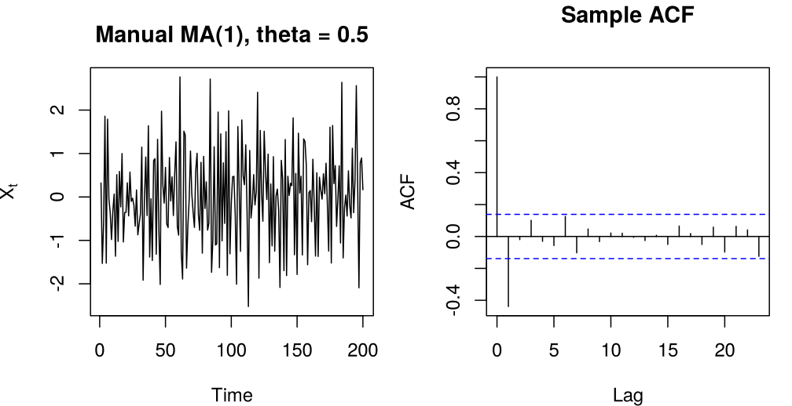
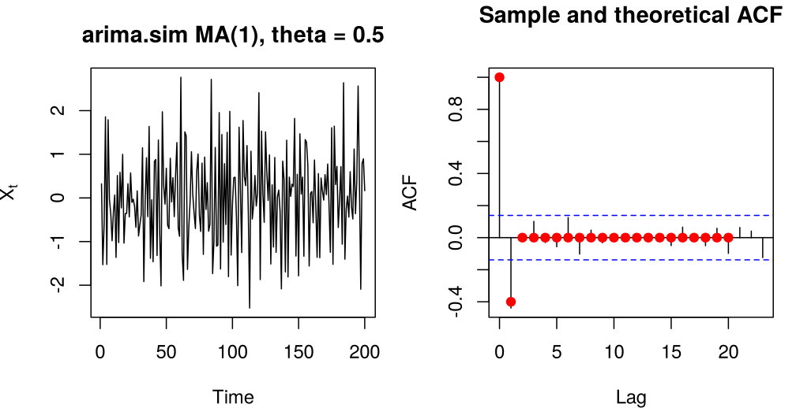
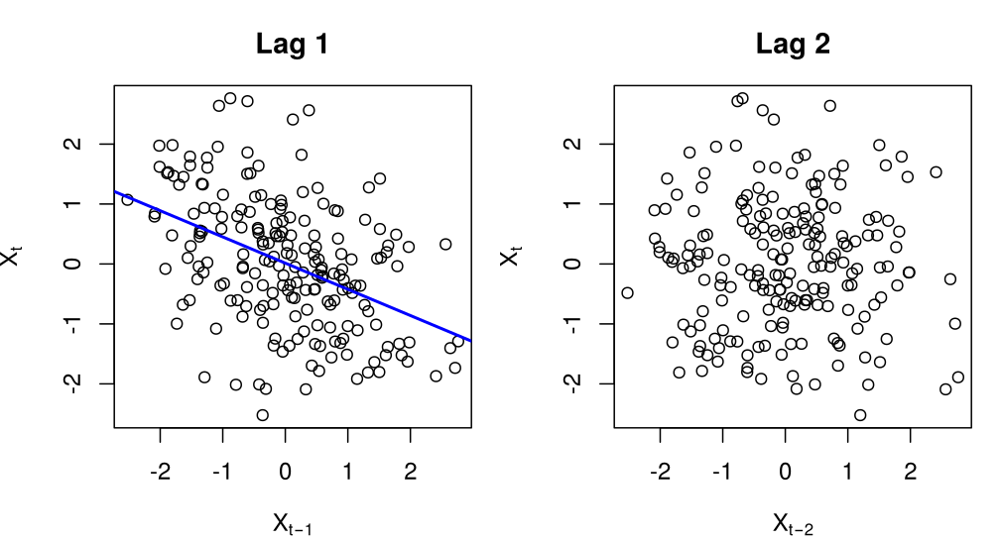
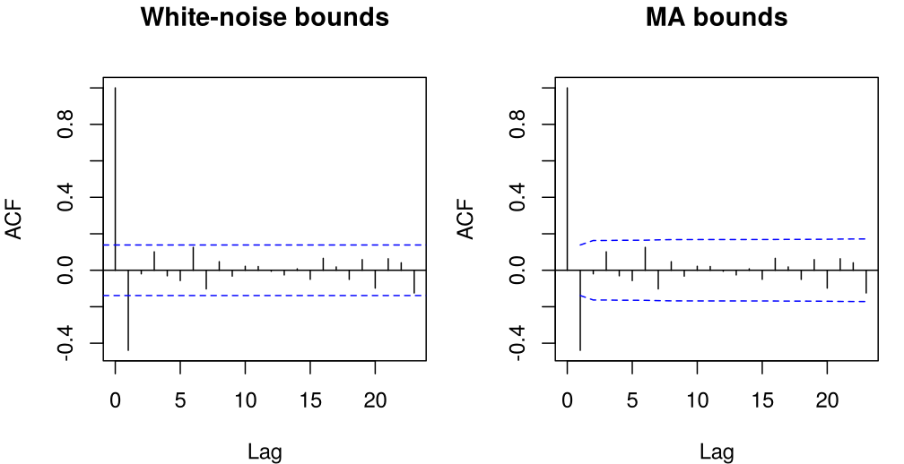
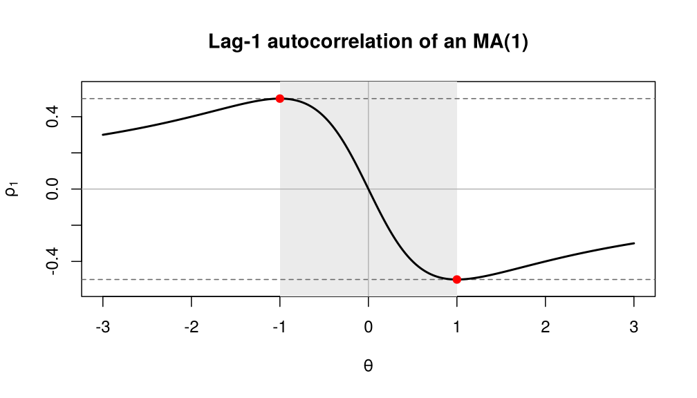
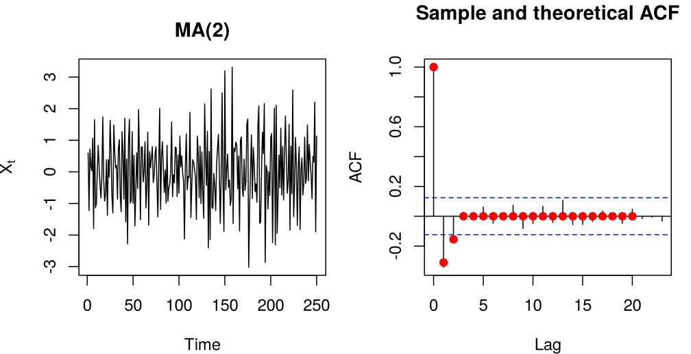
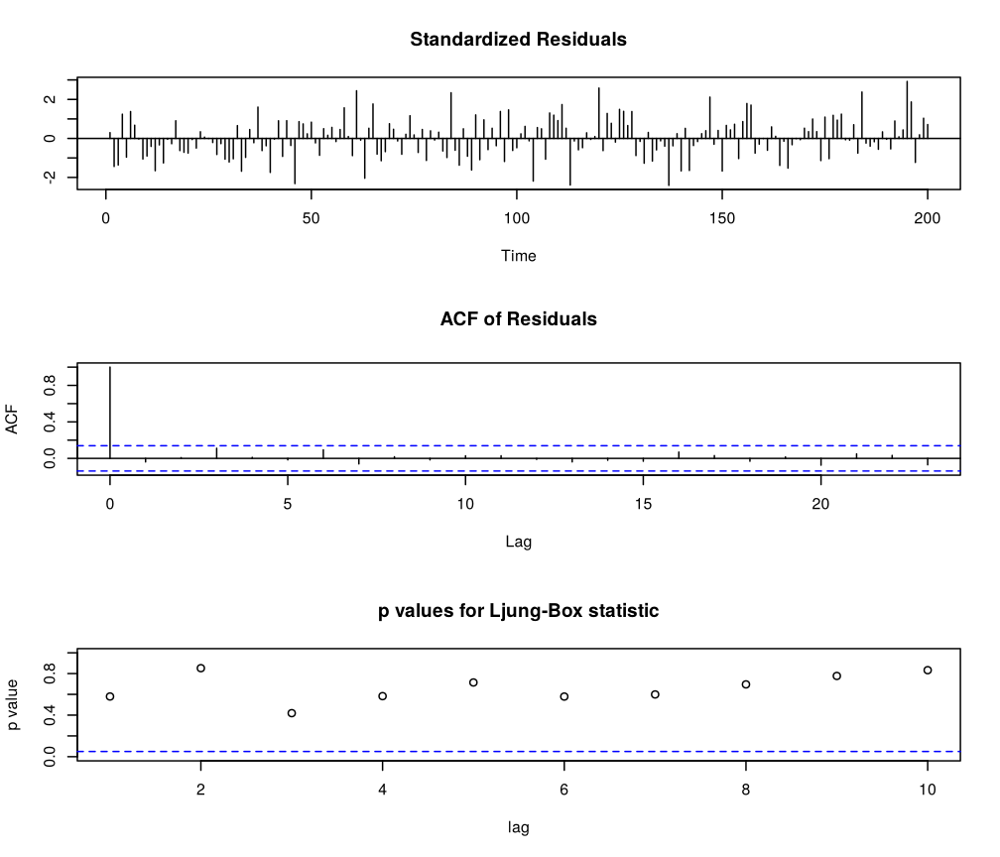
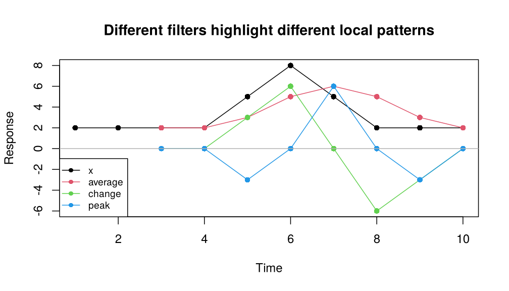

# Chapter 3: Moving Average (MA) Models

- [In-class R demo](https://watthanan-jat.github.io/SCIM311-Statistical-Modelling/demos/chapter03_in-class_demo.html)

## 1. The backshift operator

Let $\lbrace X_t : t \in \mathbb{Z} \rbrace$ be a time series process. The
**backshift operator** $B$ shifts the time index one period into the past.

> **Definition (Backshift operator).** The backshift operator $B$ acts on a
> process by
>
> ```math
> B\lbrace X_t \rbrace = \lbrace X_{t-1} \rbrace ,
> ```
>
> or simply $BX_t = X_{t-1}$. Applying it $n$ times gives
> $B^n X_t = X_{t-n}$. The inverse operator shifts one step ahead:
> $B^{-1}X_t = X_{t+1}$.

> **Key properties (Backshift operator).**
>
> 1. $B^0 X_t = X_t$.
> 2. $B^m B^n X_t = B^{m+n} X_t$.
> 3. $B$ is linear: for constants $a, b \in \mathbb{R}$ and processes
>    $X_t, Y_t$,
>
> ```math
> (aB^m + bB^n)(X_t + Y_t) = aX_{t-m} + bX_{t-n} + aY_{t-m} + bY_{t-n}.
> ```

This notation lets us write time series equations concisely and manipulate
them algebraically, treating polynomials in $B$ like ordinary polynomials.

> **Question.** Write $(1 - 0.5B)X_t$ without the operator $B$.


<!-- SHORT_ANSWER: GitHub and website only, not in the PDF -->
<details>
<summary>Show answer</summary>

$(1 - 0.5B)X_t = X_t - 0.5\,X_{t-1}$.

</details>

> **Question (More practice with $B$).**
>
> 1. Write $X_t - 2X_{t-1} + X_{t-2}$ as a polynomial in $B$ applied to $X_t$.
> 2. Write $(1 - 0.4B)(1 + 0.5B)X_t$ without the operator $B$.
> 3. Show that $(1 - B)(1 + B + B^2)X_t = X_t - X_{t-3}$.


<!-- SHORT_ANSWER: GitHub and website only, not in the PDF -->
<details>
<summary>Show answer</summary>

1. $(1 - 2B + B^2)X_t = (1 - B)^2X_t$.
2. $X_t + 0.1X_{t-1} - 0.2X_{t-2}$.
3. $(1 - B)(1 + B + B^2) = 1 - B^3$, so the expression is $X_t - X_{t-3}$.

</details>

## 2. Moving average (MA) models

We now begin our study of **stationary time series models**. They are the
building blocks of the general class of **ARMA($p, q$)** processes, which
combine *autoregressive (AR)* and *moving average (MA)* components. Recall that
a (weakly) stationary process has a constant mean and variance, and its
autocovariance depends only on the lag. Most real series are not stationary in
their raw form, but they can often be made stationary by differencing or
detrending. In this chapter we study only the **MA($q$)** part, the simpler
component of the ARMA model; AR and ARMA models follow in the next chapters.

A **moving average (MA)** model expresses each observation as a linear
combination of the current value $\epsilon_t$ of a white noise process and a
few previous values, that is, of uncorrelated random variables (many books
call these white noise terms *shocks* or *innovations*). This makes the MA
model a convenient description of short-term dependence in a stationary
process.

### 2.1 The MA($\infty$) representation

Why are moving averages so central? A fundamental theorem of Wold says that,
apart from a perfectly predictable component, every stationary process is an
infinite moving average of its own one-step prediction errors.

> **Key properties (Wold decomposition).** Let $\lbrace X_t \rbrace$ be a
> weakly stationary process with mean $\mu$ that is *nondeterministic*, that
> is, $X_t$ cannot be predicted without error by linear combinations of
> $X_{t-1}, X_{t-2}, \dots$. Then
>
> ```math
> X_t - \mu = \sum_{j=0}^{\infty}\psi_j\epsilon_{t-j} + V_t ,
> ```
>
> where
>
> 1. $\psi_0 = 1$ and $\sum_{j\ge0}\psi_j^2 < \infty$;
> 2. $\epsilon_t$ is the one-step prediction error of $X_t$ from its infinite
>    past (by the best linear predictor), and $\lbrace\epsilon_t\rbrace$ is
>    white noise: uncorrelated, with mean $0$ and constant variance
>    $\sigma^2_\epsilon$, but *not necessarily independent*;
> 3. $\text{Cov}(\epsilon_s, V_t) = 0$ for all $s$ and $t$;
> 4. $\lbrace V_t\rbrace$ is *deterministic*: it can be predicted without
>    error from its own past (for example $V_t = A_1\cos(\omega t) + A_2\sin(\omega t)$
>    with uncorrelated random $A_1$, $A_2$ of mean $0$ and equal variance).
>
> The sequences $\lbrace\psi_j\rbrace$, $\lbrace\epsilon_t\rbrace$ and
> $\lbrace V_t\rbrace$ are unique. For stationary ARMA processes
> (this chapter and the next two) $V_t = 0$: they are *purely nondeterministic*.

The theorem is a statement about second moments only. It says nothing about
the distribution of the $\epsilon_t$, and they need not be iid: white noise as
defined in Chapter 2 is uncorrelated, and the theorem does not need
independence. Nor does it say that the MA($\infty$) form is the most
economical description; the ARMA models of the following chapters describe
the $\psi_j$ with a few parameters.

> **Further reading.** Brockwell and Davis (2002), Section 2.6; Shumway and
> Stoffer (2017), Appendix B.4.

A stationary process that is purely nondeterministic can therefore be written
as an **infinite-order moving average**:

```math
X_t = \mu + \epsilon_t + \psi_1\epsilon_{t-1} + \psi_2\epsilon_{t-2} + \cdots
    = \mu + \sum_{j=0}^{\infty} \psi_j \epsilon_{t-j},
\qquad \sum_{j=0}^{\infty} \psi_j^2 < \infty ,
```

where $\psi_0 = 1$ and $\epsilon_t$ is a white noise process with
$\text{E}(\epsilon_t) = 0$ and $\text{Var}(\epsilon_t) = \sigma^2_\epsilon$.
The condition $\sum_j \psi_j^2 < \infty$ makes the infinite sum converge (in
mean square). In backshift form,

```math
\tilde{X}_t = \psi(B)\epsilon_t ,
\qquad \tilde{X}_t = X_t - \mu ,
\qquad \psi(B) = 1 + \psi_1B + \psi_2B^2 + \cdots .
```

### 2.2 The MA($q$) model

If only the first $q$ coefficients are nonzero, we obtain a finite moving
average. In this course the MA coefficients are written with **minus signs**.

> **Definition (MA($q$) process).** A process $\lbrace X_t \rbrace$ is a
> moving average process of order $q$, MA($q$), if
>
> ```math
> X_t = \mu + \epsilon_t - \theta_1\epsilon_{t-1} - \theta_2\epsilon_{t-2}
>       - \cdots - \theta_q\epsilon_{t-q},
> ```
>
> where $\epsilon_t$ is white noise with variance $\sigma^2_\epsilon$ and
> $\theta_q \neq 0$. Equivalently, with $\tilde{X}_t = X_t - \mu$,
>
> ```math
> \tilde{X}_t = (1 - \theta_1B - \theta_2B^2 - \cdots - \theta_qB^q)\,\epsilon_t
>             =: \theta(B)\,\epsilon_t .
> ```

> **Remark.** R uses the opposite sign convention. The functions `arima()`,
> `arima.sim()` and `ARMAacf()` write an MA($q$) model as
> $X_t = \mu + \epsilon_t + \theta^{R}_1\epsilon_{t-1} + \cdots + \theta^{R}_q\epsilon_{t-q}$,
> so $\theta^{R}_j = -\theta_j$. To simulate our model we pass `ma = -theta` to R,
> and the coefficient `ma1` that `arima()` reports is
> $\hat\theta^{R}_1 = -\hat\theta_1$. All the R code in this chapter follows
> this rule.

> **Question.** Write each model in backshift form $\tilde{X}_t = \theta(B)\epsilon_t$
> and state $q$ and the coefficients $\theta_j$.
>
> 1. $\tilde{X}_t = \epsilon_t + 0.5\epsilon_{t-1}$
> 2. $\tilde{X}_t = \epsilon_t - 1.7\epsilon_{t-1} + 0.8\epsilon_{t-2}$
> 3. $\tilde{X}_t = \epsilon_t - 0.6\epsilon_{t-1} + 0.9\epsilon_{t-2} + 2\epsilon_{t-3}$


<!-- SHORT_ANSWER: GitHub and website only, not in the PDF -->
<details>
<summary>Show answer</summary>

1. $\tilde X_t = (1 + 0.5B)\epsilon_t$: MA(1), $\theta_1 = -0.5$.
2. $\tilde X_t = (1 - 1.7B + 0.8B^2)\epsilon_t$: MA(2), $\theta_1 = 1.7$,
   $\theta_2 = -0.8$.
3. $\tilde X_t = (1 - 0.6B + 0.9B^2 + 2B^3)\epsilon_t$: MA(3),
   $\theta_1 = 0.6$, $\theta_2 = -0.9$, $\theta_3 = -2$.

</details>

**Moments of an MA($q$) process.** Write $\tilde{X}_t = \sum_{j=0}^q c_j
\epsilon_{t-j}$ with $c_0 = 1$ and $c_j = -\theta_j$. Since the $\epsilon_t$
are uncorrelated with common variance $\sigma^2_\epsilon$, for $h \ge 0$

```math
\gamma_h = \text{Cov}(X_t, X_{t+h})
         = \sum_{j=0}^{q}\sum_{k=0}^{q} c_j c_k\,\text{Cov}(\epsilon_{t-j}, \epsilon_{t+h-k})
         = \sigma^2_\epsilon \sum_{j=0}^{q-h} c_j c_{j+h},
```

and the sum is empty (so $\gamma_h = 0$) when $h > q$. In terms of the
$\theta_j$ this gives the following properties.

> **Key properties (MA($q$) process).**
>
> - The process is **always (weakly) stationary**: it is a finite linear
>   combination of white noise terms, so its mean and autocovariances do not
>   depend on $t$.
> - **Mean:** $\text{E}(X_t) = \mu$.
> - **Variance:** $\text{Var}(X_t) = \sigma^2_\epsilon(1 + \theta_1^2 + \theta_2^2 + \cdots + \theta_q^2)$.
> - **Autocovariance** ($\gamma_{-h} = \gamma_h$):
>
> ```math
> \gamma_h = \begin{cases}
> \sigma^2_\epsilon\left(1 + \sum_{j=1}^q \theta_j^2\right), & h = 0, \\
> \sigma^2_\epsilon\left(-\theta_h + \theta_1\theta_{h+1} + \theta_2\theta_{h+2} + \cdots + \theta_{q-h}\theta_q\right), & 1 \le h \le q, \\
> 0, & h > q.
> \end{cases}
> ```
>
> - The ACF $\rho_h = \gamma_h/\gamma_0$ **cuts off after lag $q$**:
>   $\rho_q \neq 0$ and $\rho_h = 0$ for all $h > q$.
> - The process may or may not be **invertible**, depending on the roots of
>   the polynomial $\theta(z)$.

> **Remark (Invertibility).** An MA($q$) process is *invertible* if all roots
> of $\theta(z) = 1 - \theta_1 z - \cdots - \theta_q z^q = 0$ lie outside the
> unit circle, $|z| > 1$. Then $\epsilon_t$ can be written as a convergent
> linear combination of $X_t, X_{t-1}, X_{t-2}, \dots$, so the white noise can be recovered from the present and past observations; this is what we need for estimation and
> forecasting. For an MA(1) the condition is $|\theta_1| < 1$.

### 2.3 The MA(1) model

The MA(1) model with mean zero is

```math
X_t = \epsilon_t - \theta\,\epsilon_{t-1},
```

where we write $\theta$ for $\theta_1$. From the properties above,

```math
\text{E}(X_t) = 0, \qquad
\text{Var}(X_t) = \sigma^2_\epsilon(1 + \theta^2), \qquad
\gamma_1 = -\theta\,\sigma^2_\epsilon ,
```

so the ACF is

```math
\rho_h = \begin{cases}
-\dfrac{\theta}{1 + \theta^2}, & h = 1, \\[1ex]
0, & h > 1.
\end{cases}
```

The ACF cuts off sharply after lag 1: each white noise term affects only the
current and the next observation.

> **Question.** For the MA(1) model with $\theta = 0.5$,
> $X_t = \epsilon_t - 0.5\,\epsilon_{t-1}$, calculate the mean, the variance
> and the ACF.


<!-- SHORT_ANSWER: GitHub and website only, not in the PDF -->
<details>
<summary>Show answer</summary>

$\text{E}(X_t) = 0$, $\text{Var}(X_t) = 1.25\,\sigma^2_\epsilon$,
$\rho_1 = -0.5/1.25 = -0.4$ and $\rho_h = 0$ for $h \ge 2$.

</details>

<!-- box: rexample -->
**R example: Simulating an MA(1) with $\theta = 0.5$**

*By hand.* We generate $n + 1$ Gaussian (iid) white noise values
$\epsilon_0, \dots, \epsilon_n$ and form
$X_t = \epsilon_t - 0.5\,\epsilon_{t-1}$ for $t = 1, \dots, n$.


```r
set.seed(11)
n <- 200
theta <- 0.5
eps <- rnorm(n + 1)                    # epsilon_0, ..., epsilon_n
x_manual <- eps[-1] - theta * eps[-(n + 1)]

par(mfrow = c(1, 2), mar = c(4, 4, 3, 1))
plot.ts(x_manual, main = "Manual MA(1), theta = 0.5",
        xlab = "Time", ylab = expression(X[t]))
acf(x_manual, main = "Sample ACF")
par(mfrow = c(1, 1))
```



*Figure 3.1. An MA(1) series with theta = 0.5 simulated by hand, and its sample ACF.*

*With `arima.sim()`.* Because of R's sign convention (see the remark above),
the model $X_t = \epsilon_t - 0.5\,\epsilon_{t-1}$ is entered as `ma = -0.5`.
The same convention holds for `ARMAacf()`, which returns the theoretical ACF;
it is drawn as red points on the sample ACF.


```r
set.seed(11)
x <- arima.sim(model = list(ma = -theta), n = 200)   # ma = -theta

par(mfrow = c(1, 2), mar = c(4, 4, 3, 1))
plot(x, main = "arima.sim MA(1), theta = 0.5",
     xlab = "Time", ylab = expression(X[t]))
acf(x, main = "Sample and theoretical ACF")
points(0:20, ARMAacf(ma = -theta, lag.max = 20), col = "red", pch = 19)
par(mfrow = c(1, 1))
```



*Figure 3.2. An MA(1) series with theta = 0.5 simulated by arima.sim(ma = -0.5); red points show the theoretical ACF.*

With the same seed, `arima.sim()` returns exactly the series built by hand
(`all.equal(x_manual, as.numeric(x))` is TRUE),
which confirms that `ma = -0.5` is our model with $\theta = 0.5$. The only
clear spike of the sample ACF is at lag 1, close to
the theoretical value $\rho_1 = -0.4$; the other sample autocorrelations stay
within the dashed bounds $\pm 1.96/\sqrt{n}$.

*Lag plots.* Plotting $X_t$ against $X_{t-1}$ and $X_{t-2}$ shows the same
thing directly.


```r
lagged <- embed(as.numeric(x), 3)  # columns X_t, X_{t-1}, X_{t-2}
x_now <- lagged[, 1]
x_lag1 <- lagged[, 2]
x_lag2 <- lagged[, 3]

par(mfrow = c(1, 2), mar = c(4, 4, 3, 1))
plot(x_lag1, x_now, main = "Lag 1",
     xlab = expression(X[t - 1]), ylab = expression(X[t]))
abline(lm(x_now ~ x_lag1), col = "blue", lwd = 2)
plot(x_lag2, x_now, main = "Lag 2",
     xlab = expression(X[t - 2]), ylab = expression(X[t]))
par(mfrow = c(1, 1))

round(c(lag1 = cor(x_now, x_lag1), lag2 = cor(x_now, x_lag2)), 3)
```

```
#>   lag1   lag2
#> -0.439 -0.020
```



*Figure 3.3. Lag plots of the simulated MA(1) at lag 1 (with least-squares line) and at lag 2.*

The lag-1 plot shows a clear negative association (sample correlation
$r = -0.44$), while the lag-2 plot is a patternless cloud
(sample correlation $r = -0.02$).
<!-- /box -->

**Bounds for an MA($q$) cut-off.** The dashed bounds $\pm 1.96/\sqrt{n}$ test
the hypothesis that the series is iid noise (Chapter 2). To judge whether the
ACF cuts off after lag $q$, we need the variance of $\hat\rho_h$ for $h > q$
when the series *is* MA($q$). Bartlett's formula (Chapter 2, Section 2.5) with
$\rho_h = 0$ for $h > q$ leaves only the terms $\rho_{m-h}^2$, which run over
$\rho_{-q}^2, \dots, \rho_q^2$, so

```math
\text{Var}(\hat\rho_h) \approx \frac{1}{n}\Big(1 + 2\sum_{j=1}^{q}\rho_j^2\Big),
\qquad h > q .
```

In practice the $\rho_j$ are replaced by the sample values $\hat\rho_j$. In R,
`acf(x, ci.type = "ma")` draws at each lag $h$ the bounds
$\pm 1.96\,n^{-1/2}\big(1 + 2\sum_{j=1}^{h-1}\hat\rho_j^2\big)^{1/2}$, that
is, the bounds for testing $\rho_h = 0$ under the hypothesis that the process
is MA($h-1$) (see `?plot.acf`). At lag 1 they coincide with the white-noise
bounds, and they widen with the lag as the sum grows.


```r
par(mfrow = c(1, 2), mar = c(4, 4, 3, 1))
acf(x, main = "White-noise bounds")
acf(x, ci.type = "ma", main = "MA bounds")
par(mfrow = c(1, 1))

r1 <- acf(x, plot = FALSE)$acf[2]
1.96 * sqrt(c(white_noise = 1, MA1 = 1 + 2 * r1^2) / length(x))
```

```
#> white_noise         MA1
#>   0.1385929   0.1631339
```



*Figure 3.4. Sample ACF of the simulated MA(1) with the white-noise bounds (left) and the MA bounds of ci.type = 'ma' (right).*

For lags $h \ge 2$ the MA(1) bounds are
$\pm 0.163$ instead of
$\pm 0.139$. The white-noise bounds are
narrower; used to judge a cut-off they make lags beyond $q$ look significant
too often and can suggest more MA terms than needed.

> **Further reading.** Brockwell and Davis (2002), Section 3.2.2; Cryer and
> Chan (2008), Section 6.1, equation (6.1.11).

**How large can $\rho_1$ be?** For an MA(1),

```math
|\rho_1| = \frac{|\theta|}{1 + \theta^2} \le \frac{1}{2},
```

because $1 + \theta^2 - 2|\theta| = (1 - |\theta|)^2 \ge 0$, with equality
only for $\theta = \pm 1$. So an MA(1) can never have a lag-1 autocorrelation
larger than $1/2$ in absolute value. Moreover, $\rho_1$ takes the same value at
$\theta$ and $1/\theta$ ($\theta \neq 0$): the ACF cannot distinguish these two models, and
invertibility ($|\theta| < 1$) selects one of them.


```r
theta_grid <- seq(-3, 3, length.out = 601)
rho1 <- -theta_grid / (1 + theta_grid^2)

plot(theta_grid, rho1, type = "n", ylim = c(-0.55, 0.55),
     main = "Lag-1 autocorrelation of an MA(1)",
     xlab = expression(theta), ylab = expression(rho[1]))
rect(-1, -1, 1, 1, col = "grey92", border = NA)
abline(h = c(-0.5, 0.5), lty = 2, col = "grey40")
abline(h = 0, v = 0, col = "grey70")
lines(theta_grid, rho1, lwd = 2)
points(c(-1, 1), c(0.5, -0.5), pch = 19, col = "red")
```



*Figure 3.5. Lag-1 autocorrelation of an MA(1) process as a function of theta; the shaded region is the invertible range |theta| < 1.*

An MA(1) process has no autocorrelation beyond lag 1. To obtain
autocorrelation at higher lags we increase the order of the process.

### 2.4 The MA(2) model

The MA(2) model with mean zero is

```math
X_t = \epsilon_t - \theta_1\epsilon_{t-1} - \theta_2\epsilon_{t-2}.
```

Its variance is $\text{Var}(X_t) = \sigma^2_\epsilon(1 + \theta_1^2 + \theta_2^2)$,
its autocovariances are $\gamma_1 = \sigma^2_\epsilon(-\theta_1 + \theta_1\theta_2)$
and $\gamma_2 = -\theta_2\sigma^2_\epsilon$, and its ACF is

```math
\rho_h = \begin{cases}
\dfrac{-\theta_1(1 - \theta_2)}{1 + \theta_1^2 + \theta_2^2}, & h = 1, \\[2ex]
\dfrac{-\theta_2}{1 + \theta_1^2 + \theta_2^2}, & h = 2, \\[2ex]
0, & h > 2.
\end{cases}
```

<!-- box: example -->
**Example: MA(2)**

Let $X_t = \epsilon_t - 0.5\,\epsilon_{t-1} - 0.2\,\epsilon_{t-2}$ with
$\text{Var}(\epsilon_t) = 1$.

1. Compute $\text{Var}(X_t)$.
2. Compute $\text{Cov}(X_t, X_{t-1})$ and $\text{Cov}(X_t, X_{t-2})$.
3. Hence derive $\rho_1$ and $\rho_2$.
4. Interpret what these values say about how the correlation decays.

<!-- /box -->


<!-- SHORT_ANSWER: GitHub and website only, not in the PDF -->
<details>
<summary>Show answer</summary>

1. $\text{Var}(X_t) = 1 + 0.5^2 + 0.2^2 = 1.29$.
2. $\text{Cov}(X_t, X_{t-1}) = -0.5 + 0.1 = -0.4$ and
   $\text{Cov}(X_t, X_{t-2}) = -0.2$.
3. $\rho_1 \approx -0.310$ and $\rho_2 \approx -0.155$.
4. Negative correlation at lags 1 and 2 (weaker at lag 2), and $\rho_h = 0$
   for $h \ge 3$: each white noise term affects only three consecutive
   observations.

</details>

<!-- box: rexample -->
**R example: Simulating the MA(2) model of the example above**

We simulate the same model ($\theta_1 = 0.5$, $\theta_2 = 0.2$), entered in R
as `ma = c(-0.5, -0.2)`.


```r
set.seed(3)
theta_ma2 <- c(0.5, 0.2)
x_ma2 <- arima.sim(model = list(ma = -theta_ma2), n = 250)

par(mfrow = c(1, 2), mar = c(4, 4, 3, 1))
plot(x_ma2, main = "MA(2)", xlab = "Time", ylab = expression(X[t]))
acf(x_ma2, main = "Sample and theoretical ACF")
points(0:20, ARMAacf(ma = -theta_ma2, lag.max = 20), col = "red", pch = 19)
par(mfrow = c(1, 1))
```



*Figure 3.6. A simulated MA(2) series (theta1 = 0.5, theta2 = 0.2) and its sample ACF, with the theoretical ACF in red.*

The sample ACF has negative spikes at lags 1 and 2 and then cuts off, as the
theory predicts.
<!-- /box -->

## 3. Fitting an MA model to data

Once the order of the MA model has been identified from the pattern of the
**ACF**, we fit the model to the data by estimating its parameters, typically
by **maximum likelihood (ML)** or **least squares**. The fitted model is our
best description of how the observed series was generated.

The main R function for fitting ARIMA models and their special cases (AR, MA)
is `arima()`. Its argument `order = c(p, d, q)` specifies

- $p$, the number of autoregressive (AR) terms;
- $d$, the degree of differencing;
- $q$, the number of moving average (MA) terms.

For an MA(1) we use `order = c(0, 0, 1)`. We fit it to the series `x`
simulated above with `arima.sim()` ($\theta = 0.5$, $n = 200$).


```r
fit_ma1 <- arima(x, order = c(0, 0, 1))
fit_ma1
```

```
#>
#> Call:
#> arima(x = x, order = c(0, 0, 1))
#>
#> Coefficients:
#>           ma1  intercept
#>       -0.5235     0.0054
#> s.e.   0.0550     0.0322
#>
#> sigma^2 estimated as 0.9027:  log likelihood = -273.72,  aic = 553.43
```


The `intercept` is the estimate of the mean $\mu$. Because R writes the MA
term with a plus sign, the reported estimate
`ma1` $= -0.5235$ corresponds to
$\hat{\theta} = 0.5235$ in our convention (change the sign),
close to the true value $\theta = 0.5$.

The **Akaike information criterion (AIC)** balances *model fit* against
*complexity*:

```math
\text{AIC} = -2\ln(\hat{L}) + 2k,
```

where $\hat{L}$ is the maximised likelihood of the model and $k$ is the number
of estimated parameters. In `arima()` the count $k$ includes the mean and
$\sigma^2_\epsilon$, so $k = 3$ for the MA(1) above. A **smaller AIC** means a
better trade-off: the model fits well *without* overfitting. When we compare
models, for example MA(1) and MA(2), the one with the **lowest AIC** is
preferred.


```r
fit_ma2 <- arima(x, order = c(0, 0, 2))
c(MA1 = AIC(fit_ma1), MA2 = AIC(fit_ma2))
```

```
#>      MA1      MA2
#> 553.4304 554.2454
```

Here the MA(1) has the lower AIC
(553.4 against 554.2): the extra
MA(2) coefficient does not improve the fit enough to justify it.

### 3.1 Residual diagnostics and the Ljung–Box test

The **residuals** are the differences between the observed data and the
model's one-step predictions,

```math
\hat\epsilon_t = X_t - \hat{X}_t .
```

They are estimates of the white noise $\epsilon_t$ of the model. If the model
fits well, the residuals

- have mean approximately $0$,
- have constant variance, and
- are **uncorrelated over time**.

That is, once the systematic structure captured by the MA model has been
removed, what remains should look like random noise. In R, `tsdiag()` draws
three diagnostic plots:

1. **standardised residuals**: they should fluctuate randomly around zero;
2. **ACF of the residuals**: the spikes (beyond lag 0) should lie within the
   95% bounds, apart from an occasional marginal one expected by chance;
3. **p-values of Ljung–Box tests** for lags $1, 2, \dots, 10$: large p-values
   ($> 0.05$) indicate no significant autocorrelation.


```r
tsdiag(fit_ma1)
```



*Figure 3.7. Diagnostic plots from tsdiag() for the MA(1) fitted to the simulated series.*

The **Ljung–Box test** (printed by R as "Box-Ljung test") checks formally whether the residuals behave like white
noise; it is a basic diagnostic for MA, AR and ARIMA models.

**Hypotheses.** With $\rho_k$ the lag-$k$ autocorrelation of the residual
process,

```math
\begin{aligned}
H_0 &: \rho_1 = \rho_2 = \cdots = \rho_K = 0 \quad \text{(no autocorrelation)}, \\
H_1 &: \rho_k \neq 0 \text{ for at least one } k \in \lbrace 1, \dots, K \rbrace .
\end{aligned}
```

**Test statistic.**

```math
Q = n(n+2)\sum_{k=1}^{K} \frac{\hat{\rho}_k^2}{n-k},
```

where $n$ is the number of observations, $K$ is the number of lags tested and
$\hat{\rho}_k$ is the sample autocorrelation of the residuals at lag $k$.
Under $H_0$, with iid white noise $\epsilon_t$, $Q$ approximately follows a
$\chi^2$ distribution with $K - q$ degrees of freedom, where $q$ is the number
of estimated MA parameters (for an ARMA($p, q$) model, $K - p - q$). We reject
$H_0$ for large values of $Q$.

> **Remark.** `Box.test()` does not know how many parameters were estimated.
> Its default `fitdf = 0` uses $K$ degrees of freedom; for residuals of a
> fitted MA($q$) set `fitdf = q`. The p-values plotted by `tsdiag()` use
> `fitdf = 0`, so they are slightly too large.


```r
lb <- Box.test(residuals(fit_ma1), lag = 12, type = "Ljung-Box", fitdf = 1)
lb
```

```
#>
#> 	Box-Ljung test
#>
#> data:  residuals(fit_ma1)
#> X-squared = 5.9886, df = 11, p-value = 0.8741
```

| p-value | Conclusion | Interpretation |
| --- | --- | --- |
| $p > 0.05$ | Do not reject $H_0$ | No evidence of residual autocorrelation (this does not prove the model is correct) |
| $p \le 0.05$ | Reject $H_0$ | Evidence of residual autocorrelation: the model has not captured all the dependence |

Here $Q = 5.989$ on
11 degrees of freedom, and the p-value
0.8741 is larger than $0.05$. We do not reject $H_0$: there
is no evidence of residual autocorrelation, so the MA(1) model is consistent
with the data (which does not prove that it is the correct model).

## 4. Summary

- Stationary processes are the foundation of ARMA modelling.
- The backshift operator simplifies the representation and algebraic
  manipulation of models.
- An MA($q$) model builds each observation from the current white noise term
  and the $q$ previous ones, so it describes short-term correlation.
- The ACF of an MA($q$) cuts off after lag $q$; this pattern is the key to
  identifying MA models in practice.
- In R, `arima()`, `arima.sim()` and `ARMAacf()` use $+\theta^{R}_j$ with
  $\theta^{R}_j = -\theta_j$; our models use $-\theta_j$, so the signs of the
  MA coefficients must be changed.

## Chapter checkpoint

Before moving on, make sure you can answer these questions in words.

1. What role does the white noise process $\lbrace \epsilon_t \rbrace$ play in
   an MA model?
2. Why does an MA($q$) model have short memory?
3. Why does the ACF of an MA model cut off?
4. What does invertibility help us do?
5. Why are the bounds $\pm 1.96/\sqrt{n}$ too narrow for judging whether a
   sample ACF cuts off after lag $q$?

Try this: for an MA(1) model, sketch what you expect the ACF to look
like before using R. Then simulate the model and compare the sketch with the
plotted result.


<!-- SHORT_ANSWER: GitHub and website only, not in the PDF -->
<details>
<summary>Show answer</summary>

1. It is the random input: uncorrelated terms with mean $0$ and variance
   $\sigma^2_\epsilon$, from which $X_t$ is built. For an invertible model,
   $\epsilon_t$ is the part of $X_t$ that cannot be predicted linearly from
   the past.
2. $X_t$ depends only on the last $q + 1$ white noise terms, so each term
   affects only $X_t, \dots, X_{t+q}$.
3. For $h > q$, $X_t$ and $X_{t+h}$ share no white noise term, so $\rho_h = 0$; and
   $\rho_q \ne 0$ because $\theta_q \ne 0$.
4. It lets us recover the white noise from $X_t, X_{t-1}, \dots$ (needed for
   residuals, the likelihood and forecasts), and it picks one model among
   those with the same ACF ($\theta$ and $1/\theta$).
5. $\pm 1.96/\sqrt{n}$ assumes iid noise. For an MA($q$), Bartlett's formula
   gives $\text{Var}(\hat\rho_h) \approx n^{-1}(1 + 2\sum_{j=1}^q\rho_j^2)$
   for $h > q$, which is larger than $1/n$; with the narrow bounds too many
   lags look significant.

Try this: for $\theta > 0$ the ACF is $1$ at lag 0, has one negative spike
$\rho_1 = -\theta/(1 + \theta^2)$ (never beyond $\pm 1/2$), and is zero from
lag 2 on; the sample ACF shows the spike and then small values.

</details>

## Modern time-series thread 3: From short-memory models to temporal convolutions

An MA($q$) process represents the present value using the current and recent
**unobserved white noise terms**. A temporal convolution also combines nearby
quantities, but it applies a learned filter to **observed inputs or learned
features**. The two ideas should not be treated as the same model, yet the
comparison is a useful bridge from classical short-memory dependence to
temporal convolutional networks.

### Classical MA versus a causal convolution

The classical MA($q$) model is

```math
X_t = \epsilon_t - \theta_1\epsilon_{t-1} - \cdots - \theta_q\epsilon_{t-q}.
```

A one-dimensional causal convolutional feature with width $m$ is

```math
h_t^{(k)} = \sigma\left(b_k + \sum_{j=0}^{m-1} w_{j,k}\, X_{t-j}\right),
```

where $k$ indexes a learned filter, $w_{j,k}$ are trainable weights, $b_k$ is a
bias and $\sigma$ is a nonlinear activation function (not a standard deviation). "Causal" means that
$h_t$ uses only the present and the past, never future observations.

| Feature | MA($q$) | Temporal convolution |
| --- | --- | --- |
| Inputs being combined | Unobserved white noise $\epsilon_t$ | Observed values or features $X_t$ |
| Coefficients | Estimated MA parameters | Learned filter weights |
| Main role | Stochastic process model | Feature extraction or prediction |
| Nonlinearity | Linear | Often followed by ReLU or another activation |
| Interpretation | Finite memory of past white noise | Local pattern detector |

### Dilated convolution and a longer receptive field

A temporal convolutional network (TCN) can skip observations by using a
dilation $d$:

```math
h_t^{(k)} = \sigma\left(b_k + \sum_{j=0}^{m-1} w_{j,k}\, X_{t-dj}\right).
```

With width $m = 3$ and dilation $d = 4$, one filter sees $X_t$, $X_{t-4}$ and
$X_{t-8}$. Stacking layers lets the model see a long history without a
recurrent loop. This is one reason why CNN and TCN architectures are useful
for high-frequency sensor sequences.

### Use case: detecting a local vibration signature

A damaged bearing may create a short repeated pattern rather than a permanent
level shift. A bank of learned convolutional filters can search every position
for edges, oscillations and other local motifs. A later classification or
anomaly-detection head combines the filter responses into a decision.

**Activity: become the convolutional filter.** Consider
the short sequence

```math
(2, 2, 2, 2, 5, 8, 5, 2, 2, 2).
```

Apply each filter by hand at the positions where all three values are
available. Each weight vector is written in time order, that is, as (weight on
$X_{t-2}$, weight on $X_{t-1}$, weight on $X_t$); for example, the change
detector computes $X_t - X_{t-2}$.

- Local average: $w = (1/3, 1/3, 1/3)$.
- Change detector: $w = (-1, 0, 1)$.
- Peak detector: $w = (-1, 2, -1)$.

Then use R to check the calculations and to investigate how each filter
responds to noise and to a short peak. Because the filters are causal, each response is recorded
at the last time point of its window, one step after the window's centre.


```r
x_seq <- c(2, 2, 2, 2, 5, 8, 5, 2, 2, 2)

# w is in time order (oldest first); stats::filter() wants the
# weight on X_t first, hence rev(w)
apply_filter <- function(x, w) {
  as.numeric(stats::filter(x, filter = rev(w), sides = 1))
}

local_average <- apply_filter(x_seq, c(1/3, 1/3, 1/3))
change_score  <- apply_filter(x_seq, c(-1, 0, 1))
peak_score    <- apply_filter(x_seq, c(-1, 2, -1))

round(cbind(x = x_seq, local_average, change_score, peak_score), 2)

matplot(cbind(x_seq, local_average, change_score, peak_score),
        type = "o", pch = 16, lty = 1, col = 1:4,
        main = "Different filters highlight different local patterns",
        xlab = "Time", ylab = "Response")
abline(h = 0, col = "grey70")
legend("bottomleft", legend = c("x", "average", "change", "peak"),
       col = 1:4, lty = 1, pch = 16, cex = 0.8, bg = "white")
```



*Figure 3.8. Responses of three causal filters (local average, change detector, peak detector) to a short sequence with a peak.*

Questions:

1. Which filter smooths noise?
2. Which filter produces responses of opposite sign on the rising and falling
   edges?
3. Which filter responds most strongly at the centre of the peak?
4. Why must a forecasting convolution be causal?


<!-- SHORT_ANSWER: GitHub and website only, not in the PDF -->
<details>
<summary>Show answer</summary>

Responses at $t = 3, \dots, 10$: local average $2, 2, 3, 5, 6, 5, 3, 2$;
change detector $0, 0, 3, 6, 0, -6, -3, 0$; peak detector
$0, 0, -3, 0, 6, 0, -3, 0$.

1. The local average.
2. The change detector ($+3, +6$ rising, $-6, -3$ falling).
3. The peak detector ($6$ at the maximum, $t = 7$).
4. A forecast made at time $t$ may use only $X_t, X_{t-1}, \dots$; a
   non-causal filter would use future values and make validation results too
   optimistic.

</details>

