# Chapter 4: Autoregressive (AR) Models

- [In-class R demo](https://watthanan-jat.github.io/SCIM311-Statistical-Modelling/demos/chapter04_in-class_demo.html)

## 1. Definition and backshift form

In the previous chapter we studied **moving average (MA)** models, in which a
stationary series is built from the current and a finite number of past white
noise terms.
We now turn to the **autoregressive (AR)** models, in which each observation
depends on its own *past values* rather than on past white noise terms. If an MA model says
"recent white noise matters", an AR model says "recent values matter". Together, AR
and MA models form the backbone of the ARMA and ARIMA families of later
chapters.

An AR model is recursive: the current value is partly a reflection of the recent
past, plus a new white noise term. This mirrors many natural systems: today's
temperature tends to resemble yesterday's, an economic index carries momentum
from previous quarters, and the output of a mechanical system depends on its
recent states. The recursion introduces *memory* and *persistence*, which are
often visible in data as slow swings and an autocorrelation that decays
geometrically (slowly when the persistence is strong).

> **Definition (AR($p$) process).** A *$p$-th order autoregressive process*,
> AR($p$), satisfies
>
> ```math
> X_t = \phi_1 X_{t-1} + \phi_2 X_{t-2} + \dots + \phi_p X_{t-p} + \epsilon_t,
> ```
>
> where $\lbrace\epsilon_t\rbrace$ is white noise with mean zero and variance
> $\sigma^2_\epsilon$, and $\epsilon_t$ is uncorrelated with the past values
> $X_{t-1}, X_{t-2}, \dots$. The coefficients $\phi_1, \dots, \phi_p$ determine
> how strongly past values affect the present.

With the backshift operator $B$ ($BX_t = X_{t-1}$) the model becomes

```math
\phi(B)X_t = \epsilon_t, \qquad
\phi(B) := 1 - \phi_1B - \phi_2B^2 - \dots - \phi_pB^p .
```

The autoregressive operator $\phi(B)$ turns the series into white noise. The
equation is a *stochastic difference equation*, describing how random
disturbances propagate forward in time.

**Non-zero mean.** A stationary AR process with mean $\mu$ is written
$\phi(B)(X_t - \mu) = \epsilon_t$, or equivalently

```math
X_t = c + \phi_1 X_{t-1} + \dots + \phi_p X_{t-p} + \epsilon_t,
\qquad c = \mu\,(1 - \phi_1 - \dots - \phi_p).
```

The constant $c$ is not the mean. In R, the value that `arima()` reports as
`intercept` is the mean $\mu$, not $c$.

## 2. AR(1) model

The simplest member of the family is the **first-order autoregressive process**,
AR(1):

```math
X_t = \phi_1 X_{t-1} + \epsilon_t .
```

The best linear predictor of today's value from the past is the fraction
$\phi_1$ of yesterday's value. When $\phi_1 = 0$ the process reduces to white
noise; when $\phi_1$ is close to $1$ it shows strong persistence.

**MA representation of AR(1).** Substituting the equation into itself $k$ times
gives

```math
X_t = \phi_1^k X_{t-k} + \sum_{j=0}^{k-1} \phi_1^j \epsilon_{t-j} .
```

If $|\phi_1| < 1$ and $X_t$ has constant finite variance, then
$\text{E}\big[(\phi_1^k X_{t-k})^2\big] = \phi_1^{2k}\,\text{E}(X_{t-k}^2) \to 0$
as $k \to \infty$, so

```math
X_t = \sum_{j=0}^{\infty} \phi_1^j \epsilon_{t-j}
    = \epsilon_t + \phi_1\epsilon_{t-1} + \phi_1^2\epsilon_{t-2} + \cdots ,
```

an MA($\infty$) process with weights $\psi_j = \phi_1^j$. The series converges
(in mean square) exactly when $|\phi_1| < 1$. Hence the **AR(1) process is
stationary if $|\phi_1| < 1$**. For $\phi_1 = 1$ we get the random walk of
Chapter 1, which is not stationary.

> **Remark.** For $|\phi_1| > 1$ the equation does have a stationary solution,
> $X_t = -\sum_{j\ge1} \phi_1^{-j}\epsilon_{t+j}$, but it depends on *future* white noise terms (it is not *causal*) and is of no use for forecasting. Throughout the
> course, "stationary AR process" means the causal solution, which exists when
> $|\phi_1| < 1$ (and, for AR($p$), when the root condition of Section 4
> holds).

As $\phi_1$ approaches $1$, the process becomes highly correlated and drifts
slowly, a pattern often called *red noise*. When $\phi_1 < 0$, successive
values tend to alternate above and below the mean, giving an oscillating series.
The panels below use the *same* white noise for every value of $\phi_1$, so the
differences come from $\phi_1$ alone.


```r
set.seed(4)
n <- 200
eps <- rnorm(n + 100)                  # 100 extra values as burn-in
phis <- c(-0.8, -0.4, 0, 0.4, 0.8, 0.95)

par(mfrow = c(3, 2), mar = c(3, 4, 2.5, 1))
for (phi in phis) {
  # X_t = phi * X_{t-1} + epsilon_t, then drop the burn-in
  x <- filter(eps, phi, method = "recursive")[-(1:100)]
  plot(ts(x), main = bquote(phi[1] == .(phi)), xlab = "",
       ylab = expression(X[t]))
  abline(h = 0, col = "grey50", lty = 2)
}
par(mfrow = c(1, 1))
```

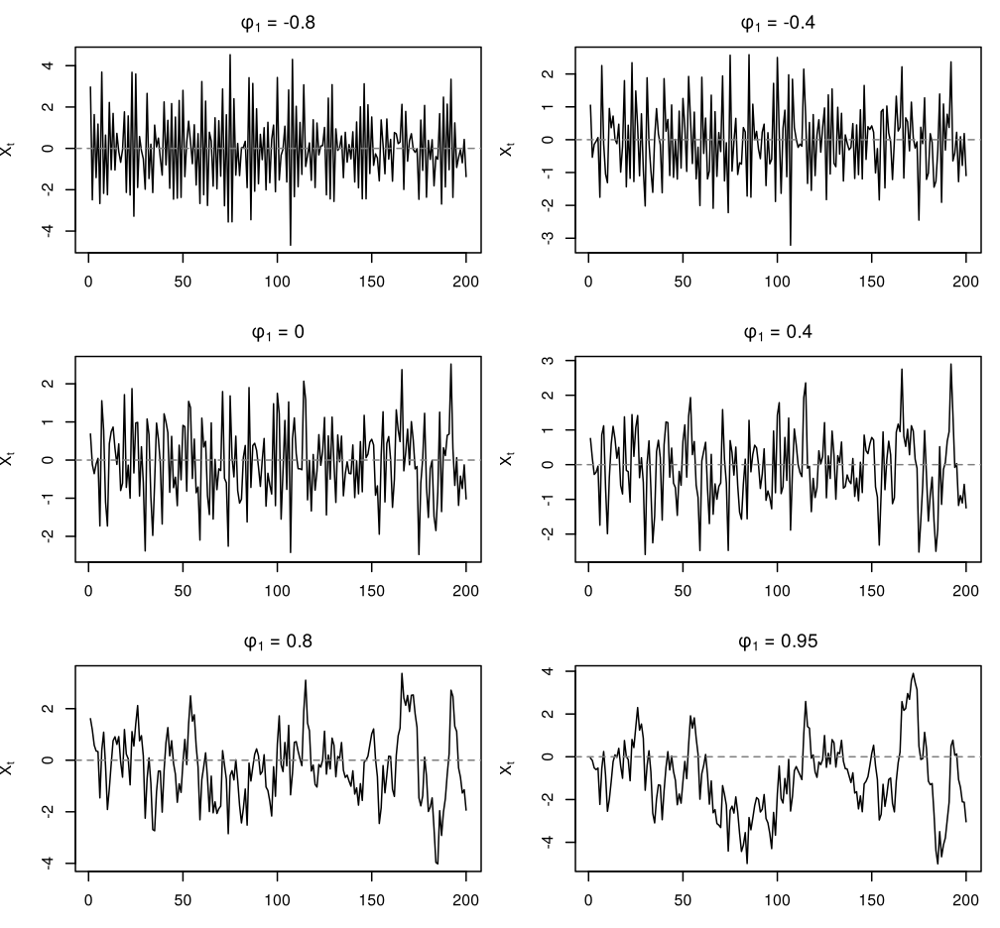

*Figure 4.1. Simulated AR(1) series with six values of phi, all driven by the same N(0, 1) noise.*

> **Key properties (Stationary AR(1)).** For $|\phi_1| < 1$,
>
> ```math
> \text{E}(X_t) = 0, \qquad
> \gamma_0 = \text{Var}(X_t) = \frac{\sigma_\epsilon^2}{1 - \phi_1^2},
> ```
>
> ```math
> \gamma_h = \frac{\sigma_\epsilon^2\,\phi_1^{h}}{1 - \phi_1^2}, \qquad
> \rho_h = \phi_1^{h}, \qquad h = 0, 1, 2, \dots
> ```
>
> (and $\rho_{-h} = \rho_h$). With a mean $\mu$, only $\text{E}(X_t) = \mu$
> changes. The ACF decays exponentially; for $\phi_1 < 0$ it alternates in sign.

These follow from the MA($\infty$) form: $\text{Var}(X_t) =
\sigma_\epsilon^2\sum_{j\ge0}\phi_1^{2j}$ and $\gamma_h =
\sigma_\epsilon^2\sum_{j\ge0}\phi_1^{j}\phi_1^{j+h}$. Alternatively, multiply
$X_t = \phi_1X_{t-1} + \epsilon_t$ by $X_{t-h}$ ($h \ge 1$) and take
expectations: $\gamma_h = \phi_1\gamma_{h-1}$, so $\gamma_h = \phi_1^h\gamma_0$.


```r
par(mfrow = c(2, 2), mar = c(4, 4, 2.5, 1))
for (phi in c(0.9, 0.4, -0.8, -0.5)) {
  rho <- ARMAacf(ar = phi, lag.max = 12)[-1]       # drop lag 0
  plot(1:12, rho, type = "h", ylim = c(-1, 1), xlab = "Lag",
       ylab = expression(rho[h]), main = bquote(phi[1] == .(phi)))
  points(1:12, rho, pch = 20)
  abline(h = 0)
}
par(mfrow = c(1, 1))
```

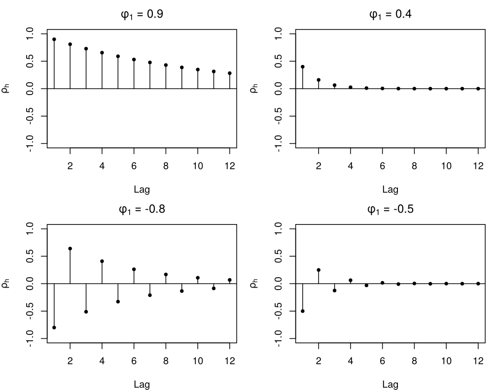

*Figure 4.2. Theoretical ACF of AR(1) processes with phi = 0.9, 0.4, -0.8 and -0.5.*

AR(1) models are the simplest illustration of how serial correlation emerges
from a stable feedback system: each new observation is a weighted echo of its
predecessor. The smaller $|\phi_1|$, the faster the process "forgets" its past.

<!-- box: rexample -->
**R example: Simulating an AR(1) process**


```r
set.seed(1)
ar1.sim <- arima.sim(model = list(ar = 0.7), n = 200)

par(mfrow = c(2, 1), mar = c(4, 4, 4, 1))
plot(ar1.sim, main = expression("Simulated AR(1) with" ~ phi[1] == 0.7),
     ylab = expression(X[t]))
acf(ar1.sim, main = "Sample ACF")
points(1:20, 0.7^(1:20), col = "red", pch = 20)   # theoretical rho_h
par(mfrow = c(1, 1))
```

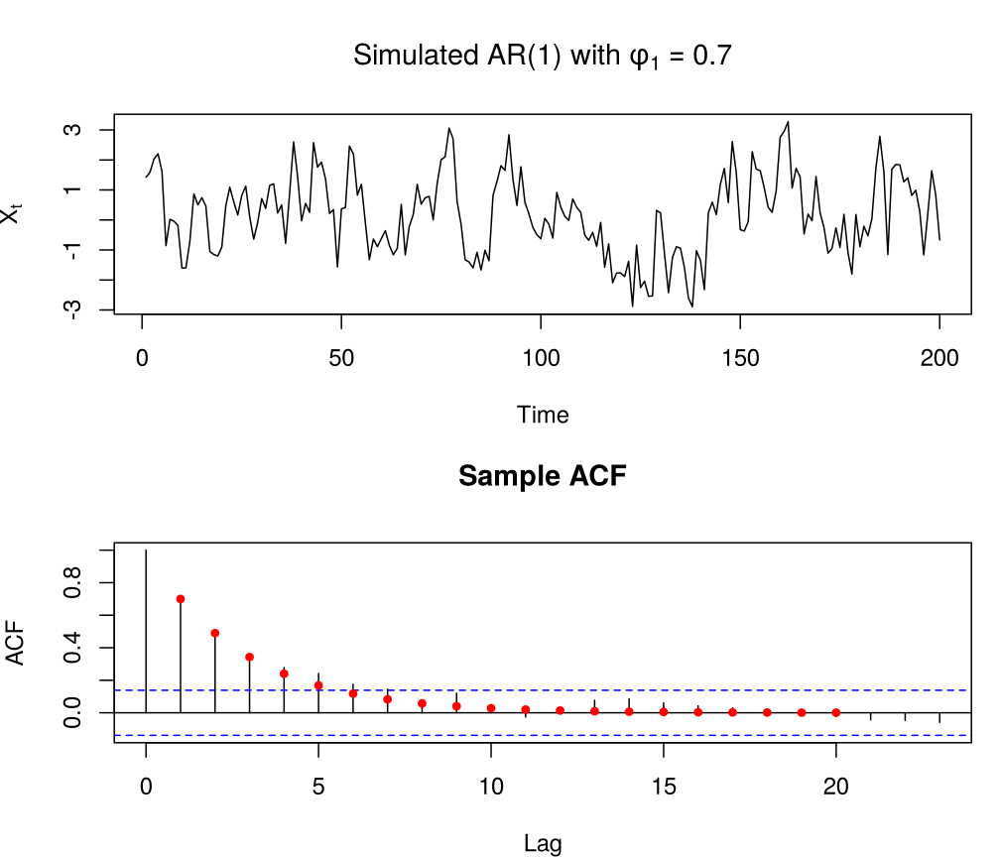

*Figure 4.3. A simulated AR(1) series with phi = 0.7 and its sample ACF; red points show the theoretical ACF 0.7^h.*

For $\phi_1 = 0.7$ the ACF declines geometrically: $\rho_1 = 0.7$,
$\rho_3 = 0.343$, $\rho_5 = 0.168$. The sample ACF
follows the theoretical values up to sampling error.
<!-- /box -->

## 3. AR(2) model

An **AR(2)** process allows richer dynamics:

```math
X_t = \phi_1 X_{t-1} + \phi_2 X_{t-2} + \epsilon_t .
```

Depending on the signs and sizes of $\phi_1$ and $\phi_2$, its ACF may decay
monotonically or as a damped oscillation.

### 3.1 Characteristic equation and stationarity

To discuss stationarity we use the **AR characteristic equation**

```math
\phi(z) = 1 - \phi_1 z - \phi_2 z^2 = 0 ,
```

a polynomial equation in a (complex) variable $z$. The AR(2) process is
stationary if both roots satisfy $|z| > 1$, that is, lie outside the unit
circle (Section 4 states this for general $p$). Writing
$\phi(z) = (1 - G_1z)(1 - G_2z)$, the reciprocal roots

```math
G_{1,2} = \frac{\phi_1 \pm \sqrt{\phi_1^2 + 4\phi_2}}{2}
```

must satisfy $|G_1| < 1$ and $|G_2| < 1$. This is equivalent to the three
inequalities

```math
\phi_1 + \phi_2 < 1, \qquad \phi_2 - \phi_1 < 1, \qquad |\phi_2| < 1 ,
```

which define the triangle in the $(\phi_1, \phi_2)$ plane below. The roots are
real when $\phi_1^2 + 4\phi_2 \ge 0$ and complex when
$\phi_1^2 + 4\phi_2 < 0$.


```r
plot(NA, xlim = c(-2, 2), ylim = c(-1, 1), xlab = expression(phi[1]),
     ylab = expression(phi[2]), main = "AR(2) stationarity region")
polygon(c(-2, 0, 2), c(-1, 1, -1), lwd = 2)
curve(-x^2 / 4, -2, 2, add = TRUE, lwd = 2)   # phi1^2 + 4 phi2 = 0
abline(h = 0, v = 0, lty = 3)
text(0, 0.35, "real roots")
text(0, -0.6, "complex roots")
text(1.3, 0.3, expression(phi[1]^2 + 4 * phi[2] == 0))
arrows(1.2, 0.2, 0.7, -0.11, length = 0.1)
points(1.3, -0.5, pch = 19, col = "red")
```

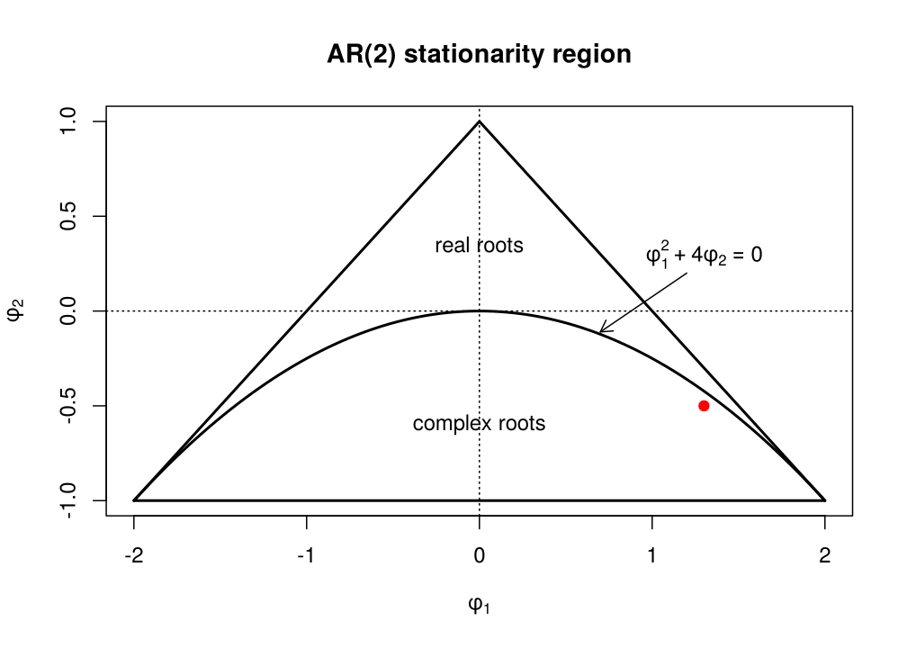

*Figure 4.4. Stationarity region of the AR(2) model; below the parabola the characteristic roots are complex. The point marks the example of Section 3.3.*

### 3.2 ACF of AR(2)

Multiplying the AR(2) equation by $X_{t-h}$, taking expectations and dividing by
$\gamma_0$ gives the **Yule–Walker equations**

```math
\rho_h = \phi_1\rho_{h-1} + \phi_2\rho_{h-2}, \qquad h = 1, 2, \dots
```

With $\rho_0 = 1$ and $\rho_{-1} = \rho_1$, the cases $h = 1, 2$ give

```math
\rho_1 = \frac{\phi_1}{1 - \phi_2}, \qquad
\rho_2 = \phi_1\rho_1 + \phi_2 = \frac{\phi_1^2 + \phi_2(1 - \phi_2)}{1 - \phi_2},
```

and further lags follow from the recursion. The variance is

```math
\gamma_0 = \text{Var}(X_t)
= \frac{1 - \phi_2}{1 + \phi_2}\cdot
  \frac{\sigma_\epsilon^2}{(1 - \phi_2)^2 - \phi_1^2} .
```

The recursion is a linear difference equation whose characteristic equation
$G^2 - \phi_1G - \phi_2 = 0$ has the roots $G_1, G_2$ above (the reciprocal roots
of $\phi(z)$), so for $G_1 \ne G_2$, $\rho_h = A_1G_1^h + A_2G_2^h$:

- **real roots:** a mixture of two exponential decays (with sign changes if a
  root is negative);
- **complex roots:** a *damped sine wave*.

In the complex case $G_{1,2} = R\,e^{\pm i\omega}$ with $R = \sqrt{-\phi_2}$ and
$\cos\omega = \phi_1 / (2R)$, and

```math
\rho_h = R^h\,\frac{\sin(\omega h + \lambda)}{\sin \lambda}, \qquad
\tan\lambda = \frac{1 - \phi_2}{1 + \phi_2}\tan\omega ,
```

so $R$ is the damping factor and $2\pi/\omega$ the period of the oscillation.


```r
pars <- list(c(0.5, 0.25), c(1.0, -0.25), c(1.5, -0.75), c(1.0, -0.6))

par(mfrow = c(2, 2), mar = c(4, 4, 2.5, 1))
for (ph in pars) {
  rho <- ARMAacf(ar = ph, lag.max = 12)[-1]
  plot(1:12, rho, type = "h", ylim = c(-0.6, 1), xlab = "Lag",
       ylab = expression(rho[h]),
       main = bquote(phi[1] == .(ph[1]) * "," ~ phi[2] == .(ph[2])))
  points(1:12, rho, pch = 20)
  abline(h = 0)
}
par(mfrow = c(1, 1))
```

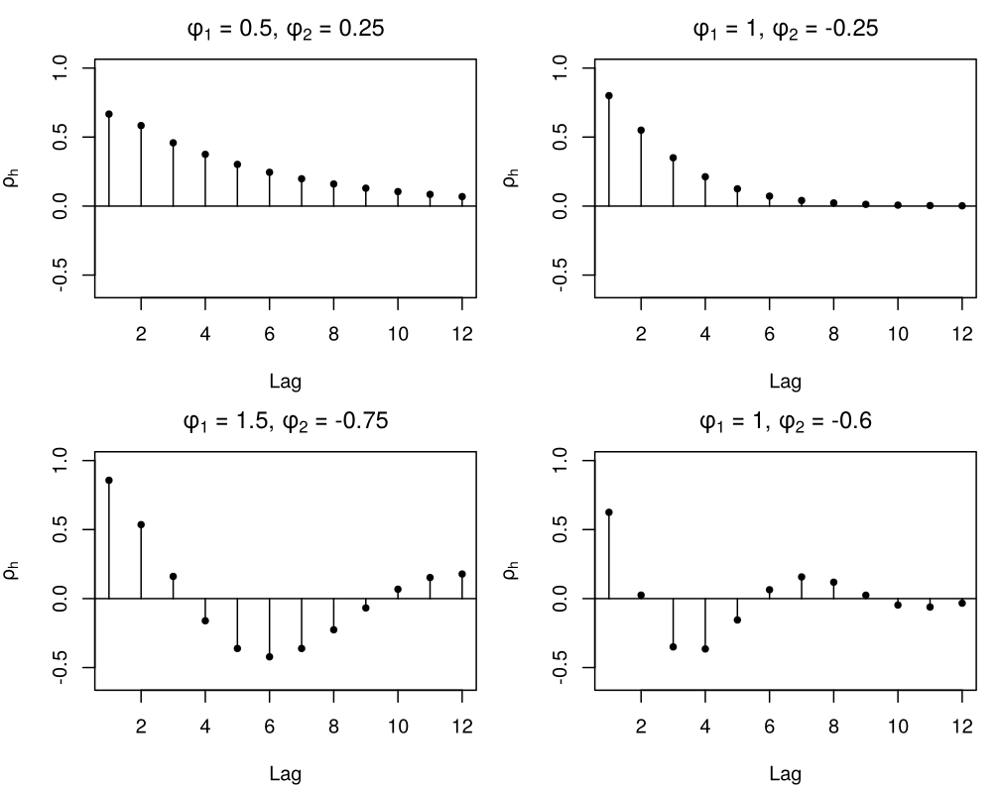

*Figure 4.5. Theoretical ACF of four stationary AR(2) processes.*

The first panel has real roots ($G = 0.81, -0.31$) and decays smoothly. The
second has a repeated root $G = 0.5$ ($\phi_1^2 + 4\phi_2 = 0$). The last two
have complex roots: for $\phi = (1.5, -0.75)$, $R = 0.866$ and
$\omega = \pi/6$, a period of $12$ lags; for $\phi = (1, -0.6)$ the period is
about $7.2$ lags with faster
damping ($R = 0.775$).

### 3.3 Simulated example

<!-- box: rexample -->
**R example: A simulated AR(2) process**

Let $\phi_1 = 1.3$ and $\phi_2 = -0.5$. Then $\phi_1 + \phi_2 = 0.8$,
$\phi_2 - \phi_1 = -1.8$ and $|\phi_2| = 0.5$, so the process is stationary, and
$\phi_1^2 + 4\phi_2 = -0.31 < 0$, so the roots are complex. We can check the
roots of $\phi(z) = 1 - 1.3z + 0.5z^2$ with `polyroot()`, which takes the
coefficients in increasing powers of $z$:


```r
roots <- polyroot(c(1, -1.3, 0.5))
roots
```

```
#> [1] 1.3+0.556776i 1.3-0.556776i
```

```r
Mod(roots)       # both > 1: stationary
```

```
#> [1] 1.414214 1.414214
```


```r
set.seed(200)
ar2.sim <- arima.sim(model = list(ar = c(1.3, -0.5)), n = 200)

par(mfrow = c(3, 1), mar = c(4, 4, 4, 1))
plot(ar2.sim, main = "Simulated AR(2)", ylab = expression(X[t]))
abline(h = 0, col = "grey50", lty = 2)
acf(ar2.sim, main = "ACF of AR(2) process")
pacf(ar2.sim, main = "PACF of AR(2) process")
par(mfrow = c(1, 1))
```

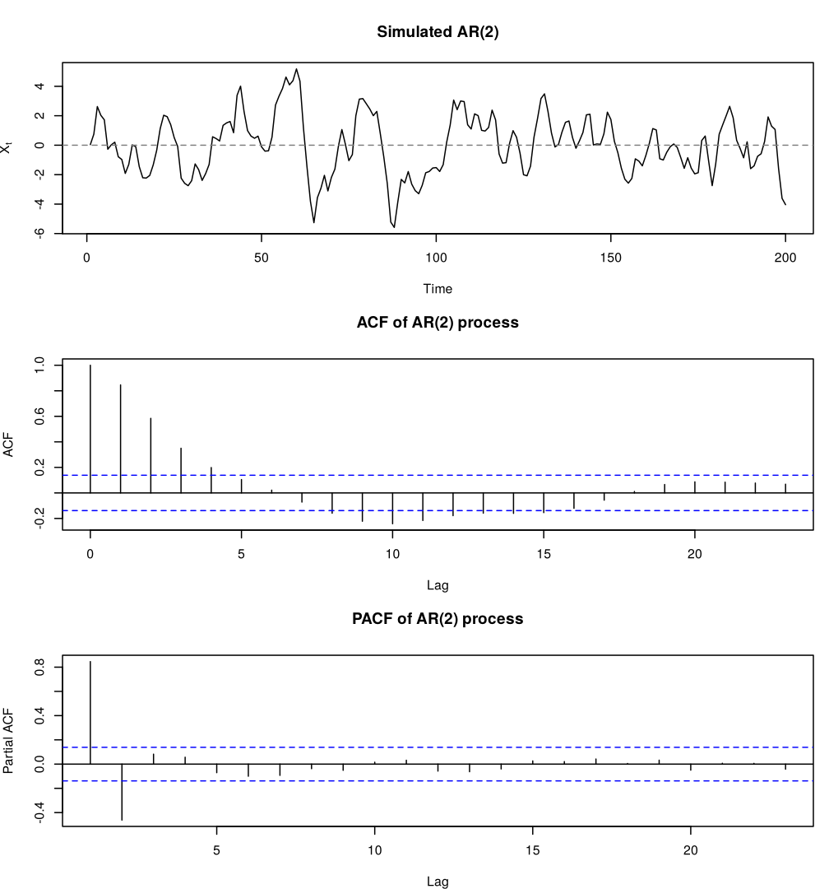

*Figure 4.6. A simulated AR(2) series with phi1 = 1.3 and phi2 = -0.5, with its sample ACF and PACF.*

Here $R = \sqrt{0.5} = 0.707$ and the period is
$2\pi/\omega \approx 15.5$ lags.
The ACF shows this damped sine wave, while the PACF has two clear spikes and
then stays inside the bounds (Section 5 explains why).
<!-- /box -->

## 4. AR($p$) model

Now consider the general AR($p$) model

```math
X_t = \phi_1 X_{t-1} + \phi_2 X_{t-2} + \dots + \phi_p X_{t-p} + \epsilon_t .
```

Its behaviour depends on the *location of the roots* of the characteristic
polynomial

```math
\phi(z) = 1 - \phi_1z - \dots - \phi_pz^p .
```

> **Key properties (Stationarity of AR($p$)).** The AR($p$) equation has a
> stationary (causal) solution
> $X_t = \sum_{j\ge0}\psi_j\epsilon_{t-j}$ with $\sum_j|\psi_j| < \infty$ if and
> only if all roots of $\phi(z) = 0$ lie *outside the unit circle*, $|z| > 1$.
> A quick necessary condition is $\phi_1 + \dots + \phi_p < 1$ (since
> $\phi(1) > 0$).

The condition ensures that the effect of each white noise term dies out over
time instead of growing: each one leaves a mark that slowly disappears, like ripples on
water after a stone is thrown. The $\psi_j$ satisfy
$\psi_0 = 1$, $\psi_j = \phi_1\psi_{j-1} + \dots + \phi_p\psi_{j-p}$ (with
$\psi_j = 0$ for $j < 0$); in R they are given by `ARMAtoMA()`.

When the condition fails, there is no causal stationary solution, and the
recursion run forward from starting values gives a **nonstationary** series. A
root on the unit
circle (a *unit root*, as in the random walk) means that the effect of a white noise term never dies out
and the series drifts; a root inside the unit circle makes the recursion
explode. In such cases differencing or a transformation is needed before
modelling (Chapter 6). For example, $\phi = (0.5, 0.6)$ fails the necessary
condition, and indeed one root lies inside the unit circle:


```r
Mod(polyroot(c(1, -0.5, -0.6)))   # one modulus < 1: not stationary
```

```
#> [1] 0.9399017 1.7732350
```

### 4.1 The Yule–Walker equations

The **Yule–Walker equations** link the parameters of an AR model to its
autocovariance function. Multiply both sides of the AR($p$) equation by
$X_{t-h}$ and take expectations. For $h \ge 1$, $\text{E}(\epsilon_tX_{t-h}) = 0$,
because $X_{t-h}$ depends only on white noise terms up to time $t-h$; for $h = 0$,
$\text{E}(\epsilon_tX_t) = \sigma^2_\epsilon$. This gives

```math
\gamma_h = \phi_1\gamma_{h-1} + \phi_2\gamma_{h-2} + \dots + \phi_p\gamma_{h-p},
\qquad h \ge 1,
```

```math
\gamma_0 = \phi_1\gamma_1 + \phi_2\gamma_2 + \dots + \phi_p\gamma_p + \sigma^2_{\epsilon},
```

where $\gamma_h = \text{Cov}(X_t, X_{t-h})$ and $\gamma_{-h} = \gamma_h$.
Dividing by $\gamma_0$, the equations for $h = 1, \dots, p$ form the linear
system

```math
\begin{bmatrix} 1 & \rho_1 & \cdots & \rho_{p-1} \\
\rho_1 & 1 & \cdots & \rho_{p-2} \\
\vdots & \vdots & \ddots & \vdots \\
\rho_{p-1} & \rho_{p-2} & \cdots & 1 \end{bmatrix}
\begin{bmatrix} \phi_1 \\ \phi_2 \\ \vdots \\ \phi_p \end{bmatrix}
=
\begin{bmatrix} \rho_1 \\ \rho_2 \\ \vdots \\ \rho_p \end{bmatrix}.
```

Given $\phi_1, \dots, \phi_p$, it can be solved for $\rho_1, \dots, \rho_p$;
the recursion then gives all later $\rho_h$, and the last equation gives
$\gamma_0 = \sigma^2_\epsilon / (1 - \phi_1\rho_1 - \dots - \phi_p\rho_p)$.
Conversely, given the autocorrelations it can be solved for the $\phi_j$:
replacing $\rho_h$ by the sample ACF $\hat\rho_h$ gives the **Yule–Walker estimates**
of the parameters. So the equations describe the theoretical shape of the ACF
and are also the basis of an estimation method.

## 5. Partial autocorrelation function (PACF)

How do we choose the order $p$ of an AR($p$) model? The ACF of an AR process
tails off at every order, so it does not show $p$ directly. The **partial
autocorrelation function (PACF)** does.

The ACF at lag $h$ contains both *direct* and *indirect* correlation (for
example, $X_t$ is correlated with $X_{t-2}$ through $X_{t-1}$). The PACF
measures the correlation between $X_t$ and $X_{t-h}$ after removing the linear
influence of the intermediate values $X_{t-1}, \dots, X_{t-h+1}$.

> **Definition (Partial autocorrelation).** For a stationary process, let
> $\hat X_t$ and $\hat X_{t-h}$ be the best linear predictors of $X_t$ and
> $X_{t-h}$ from $X_{t-1}, \dots, X_{t-h+1}$. The partial autocorrelation at lag
> $h \ge 2$ is
>
> ```math
> \phi_{hh} = \text{Corr}\big(X_t - \hat X_t,\; X_{t-h} - \hat X_{t-h}\big),
> ```
>
> and $\phi_{11} = \rho_1$. It is often written
> $\text{PACF}(h) = \text{Corr}(X_t, X_{t-h} \mid X_{t-1}, \dots, X_{t-h+1})$;
> for a Gaussian process this conditional correlation is exactly $\phi_{hh}$.

Equivalently, if we regress $X_t$ on its $h$ most recent past values,

```math
X_t = \phi_{1h} X_{t-1} + \phi_{2h} X_{t-2} + \cdots + \phi_{hh} X_{t-h} + \text{error},
```

with the coefficients of the best linear predictor, then the partial
autocorrelation at lag $h$ is the **last coefficient**, $\text{PACF}(h) =
\phi_{hh}$. It measures the direct contribution of $X_{t-h}$ once lags
$1, \dots, h-1$ are already used. This makes the PACF useful both for
identifying a model and for checking whether residual autocorrelation remains
after fitting.

### 5.1 Intuition: direct memory versus indirect memory

The ACF at lag $2$ can be positive for two different reasons.

1. $X_t$ may be directly related to $X_{t-2}$.
2. $X_t$ may only look related to $X_{t-2}$ because both are connected through
   $X_{t-1}$.

For an AR(1)-type series the second explanation is typical. If today depends
strongly on yesterday, and yesterday on the day before, then today also appears
related to the day before. That does not mean lag $2$ is needed in the model.
The PACF asks a more focused question:

> **Key idea.** After using lag $1$, does lag $2$ still add new information?

For lag $1$, $\text{PACF}(1) = \text{ACF}(1) = \rho_1$. For lag $2$, the partial
autocorrelation can be calculated from $\rho_1$ and $\rho_2$ as

```math
\phi_{22} = \frac{\rho_2 - \rho_1^2}{1 - \rho_1^2}.
```

<!-- box: example -->
**Example: Lag 2 is only indirect**

Suppose $\rho_1 = 0.8$ and $\rho_2 = 0.64$. Then

```math
\phi_{22}
= \frac{0.64 - 0.8^2}{1 - 0.8^2}
= \frac{0.64 - 0.64}{1 - 0.64}
= 0.
```

The lag-2 autocorrelation is fully explained by repeated lag-1 dependence. This
is the AR(1) pattern: for an AR(1) with $\phi_1 = 0.8$, $\rho_2 = \rho_1^2$.
<!-- /box -->

<!-- box: example -->
**Example: Lag 2 still matters**

Suppose $\rho_1 = 0.3$ and $\rho_2 = 0.5$. Then

```math
\phi_{22}
= \frac{0.5 - 0.3^2}{1 - 0.3^2}
= \frac{0.41}{0.91}
\approx 0.451.
```

After accounting for lag $1$, lag $2$ still makes a clear contribution. This
suggests that an AR(2) model may be worth considering.
<!-- /box -->

### 5.2 Computing the PACF

For a given order $h$, the coefficients $\phi_{1h}, \dots, \phi_{hh}$ solve the
Yule–Walker system of order $h$:

```math
\begin{bmatrix} 1 & \rho_1 & \rho_2 & \cdots & \rho_{h-1} \\
\rho_1 & 1 & \rho_1 & \cdots & \rho_{h-2} \\
\rho_2 & \rho_1 & 1 & \cdots & \rho_{h-3} \\
\vdots & \vdots & \vdots & \ddots & \vdots \\
\rho_{h-1} & \rho_{h-2} & \rho_{h-3} & \cdots & 1 \end{bmatrix}
\begin{bmatrix} \phi_{1h} \\ \phi_{2h} \\ \vdots \\ \phi_{hh} \end{bmatrix}
=
\begin{bmatrix} \rho_1 \\ \rho_2 \\ \vdots \\ \rho_h \end{bmatrix},
```

or compactly $R_h\boldsymbol\phi_h = \boldsymbol\rho_h$, where $R_h$ is the
$h \times h$ autocorrelation matrix and $\boldsymbol\rho_h$ the vector of
autocorrelations up to lag $h$. Hence

```math
\boldsymbol\phi_h = R_h^{-1}\boldsymbol\rho_h,
```

and the partial autocorrelation at lag $h$ is the last element of
$\boldsymbol\phi_h$, $\text{PACF}(h) = \phi_{hh}$. For $h = 2$ this gives the
formula for $\phi_{22}$ above.

**Cut-off for AR($p$).** If $X_t$ is a causal AR($p$) and $h \ge p$, the best
linear predictor of $X_t$ from $X_{t-1}, \dots, X_{t-h}$ is
$\phi_1X_{t-1} + \dots + \phi_pX_{t-p}$, so the last coefficient is $\phi_p$
for $h = p$ and zero for $h > p$:

```math
\phi_{pp} = \phi_p, \qquad \phi_{hh} = 0 \quad \text{for } h > p .
```

For a sample of size $n$ from an AR($p$) process with iid white noise, the
sample PACF at lags
$h > p$ is approximately $N(0, 1/n)$, which gives the dashed bounds
$\pm 1.96/\sqrt{n} \approx \pm 2/\sqrt{n}$ drawn by `pacf()`. For the AR(2) of Section 3.3:


```r
round(ARMAacf(ar = c(1.3, -0.5), lag.max = 5, pacf = TRUE), 3)
```

```
#> [1]  0.867 -0.500  0.000  0.000  0.000
```

Here $\phi_{11} = \rho_1 = 1.3/1.5$, $\phi_{22} = \phi_2 = -0.5$ and the
remaining values are zero.

**Durbin–Levinson recursion (non-examinable).** In practice $\phi_{hh}$ is
computed recursively from the autocorrelations. Start with
$\phi_{11} = \rho_1$. For $h = 2, 3, \dots$

```math
\phi_{hh}
=
\frac{
\rho_h - \sum_{j=1}^{h-1}\phi_{h-1,j}\,\rho_{h-j}
}{
1 - \sum_{j=1}^{h-1}\phi_{h-1,j}\,\rho_j
},
\qquad
\phi_{hj} = \phi_{h-1,j} - \phi_{hh}\,\phi_{h-1,h-j}, \quad j = 1, \dots, h-1.
```

Each step gives the new PACF value $\phi_{hh}$ and the updated coefficients of
the order-$h$ predictor.

### 5.3 ACF and PACF patterns

The ACF and PACF are the key empirical tools for identifying AR and MA orders.

- For an **AR($p$)** process, the PACF *cuts off* after lag $p$ and the ACF
  tails off.
- For an **MA($q$)** process, the PACF *tails off* gradually and the ACF cuts
  off after lag $q$.
- After fitting a model, the residual ACF and PACF should show no significant
  spikes.

| Plot pattern | First model idea | Meaning |
| --- | --- | --- |
| ACF tails off, PACF cuts off after lag $p$ | AR($p$) | dependence is mainly through direct past values |
| ACF cuts off after lag $q$, PACF tails off | MA($q$) | dependence is mainly through recent white noise terms |
| ACF starts near $1$ and decays almost linearly | difference first | trend or nonstationarity may be present |

These complementary patterns allow us to distinguish autoregressive from
moving-average structure. In practice we inspect both plots together and choose
the simplest model that matches the observed pattern.

## 6. Model fitting and forecasting

<!-- box: example -->
**Example: Level of Lake Huron, 1875–1972**

The built-in series `LakeHuron` gives the annual level of Lake Huron in feet
(Chapter 1). It is a standard example of an autoregressive series: high years
tend to follow high years, and the level returns slowly to its average.


```r
plot(LakeHuron, main = "Level of Lake Huron, 1875-1972",
     xlab = "Year", ylab = "Level (feet)")
abline(h = mean(LakeHuron), col = "grey50", lty = 2)
```

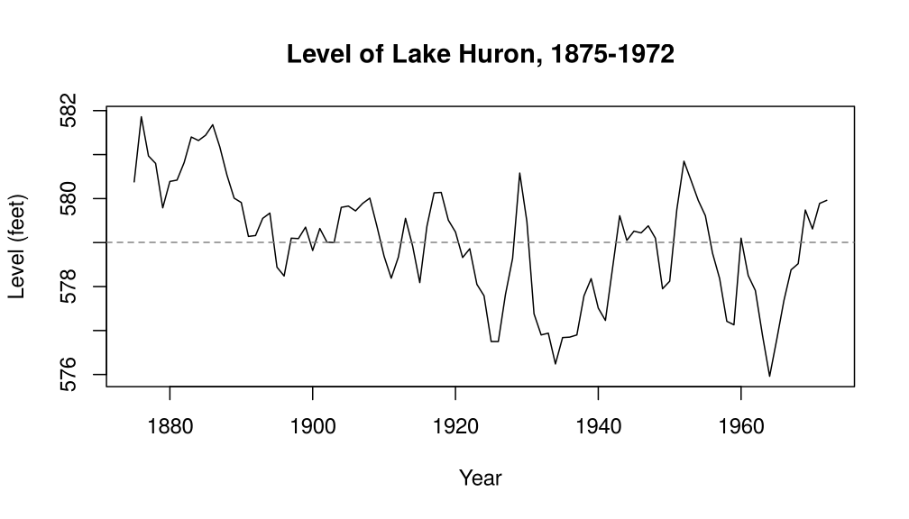

*Figure 4.7. Annual level of Lake Huron (feet), 1875-1972, with its sample mean.*

```r
summary(LakeHuron)
```

```
#>    Min. 1st Qu.  Median    Mean 3rd Qu.    Max.
#>   576.0   578.1   579.1   579.0   579.9   581.9
```
<!-- /box -->

> **Question.** Does this series look stationary?


<!-- SHORT_ANSWER: GitHub and website only, not in the PDF -->
<details>
<summary>Show answer</summary>

Plausibly yes, as a working assumption: no seasonality, no change in spread,
and the level keeps returning towards about 579 feet. The sample ACF
($0.83, 0.61, 0.46, \dots$) decays much faster than for a random walk. The
slight downward drift is the doubt; we check the fitted model's residuals,
which cannot fully rule out a trend.

</details>

The level wanders in long swings around a mean of about
$579$ feet without an obvious change in variance. In
Chapter 1 we fitted a slight linear decline; here we treat the series as
stationary around a constant mean, a common first model whose adequacy we check
below. Next we look at the ACF and PACF.


```r
par(mfrow = c(2, 1), mar = c(4, 4, 4, 1))
acf(LakeHuron, lag.max = 12, main = "ACF of LakeHuron")
pacf(LakeHuron, lag.max = 12, main = "PACF of LakeHuron")
par(mfrow = c(1, 1))
```

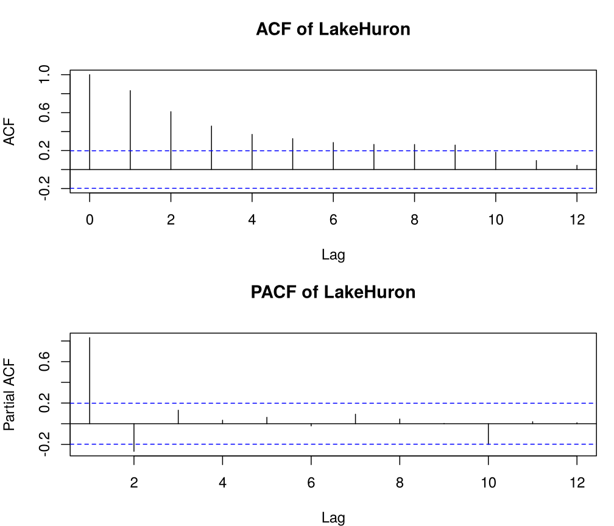

*Figure 4.8. Sample ACF and PACF of the Lake Huron levels.*


The ACF tails off gradually. The PACF has a large spike at lag 1
($0.83$), a clear negative spike at lag 2
($-0.27$), and then stays within the bounds
$\pm 1.96/\sqrt{98} = \pm 0.198$, except for
a marginal value at lag 10 ($-0.200$). With ten
lags inspected beyond lag 2, where the sample PACF of an AR(2) behaves
approximately like independent $N(0, 1/n)$ values, at least one exceedance
occurs by chance with probability about $1 - 0.95^{10} \approx 0.4$, so we do
not read it as structure. This suggests an AR(2) model.

### 6.1 Model fitting and diagnostics

**Step 1: fit the model.**


```r
fit_ar2 <- arima(LakeHuron, order = c(2, 0, 0))
fit_ar2
```

```
#>
#> Call:
#> arima(x = LakeHuron, order = c(2, 0, 0))
#>
#> Coefficients:
#>          ar1      ar2  intercept
#>       1.0436  -0.2495   579.0473
#> s.e.  0.0983   0.1008     0.3319
#>
#> sigma^2 estimated as 0.4788:  log likelihood = -103.63,  aic = 215.27
```


```r
phi_hat <- unname(coef(fit_ar2)[1:2])   # estimated phi_1, phi_2
mu_hat <- unname(coef(fit_ar2)[3])      # estimated mean ("intercept")
```

The fitted model is

```math
X_t - \hat\mu = 1.044\,(X_{t-1} - \hat\mu)
  -0.249\,(X_{t-2} - \hat\mu) + \epsilon_t,
\qquad \hat\mu = 579.05,
```

with $\hat\sigma^2_\epsilon = 0.479$. The `intercept` is
the estimated mean $\hat\mu$; the constant of the form $X_t = c + \dots$ is
$\hat c = \hat\mu(1 - \hat\phi_1 - \hat\phi_2) =
119.22$. The fitted coefficients satisfy
the stationarity conditions, and the moduli of the characteristic roots are
1.49 and 2.70,
both greater than $1$.

**Step 2: check the diagnostics.**


```r
tsdiag(fit_ar2)
```

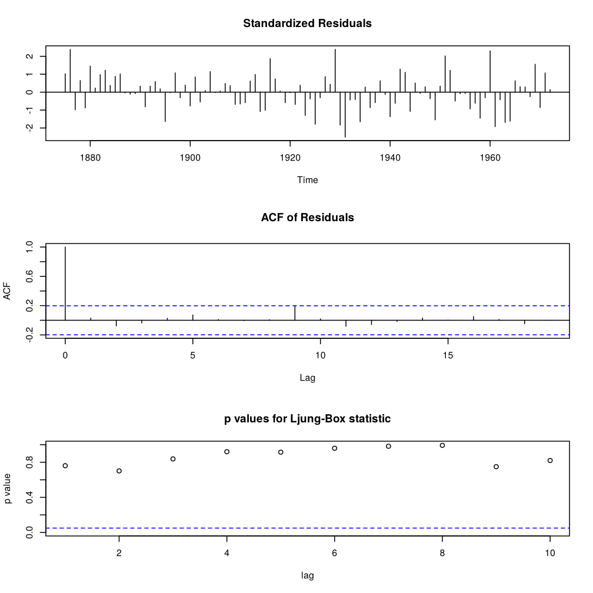

*Figure 4.9. Diagnostic plots for the AR(2) model fitted to the Lake Huron levels.*

Interpret the three diagnostic plots:

1. **Standardised residuals:** should look like white noise with constant
   variance.
2. **ACF of residuals:** the autocorrelations should lie within the 95% bounds,
   apart from an occasional marginal one expected by chance.
3. **p-values of the Ljung–Box test:** most should be above 0.05, indicating no
   remaining autocorrelation. (`tsdiag()` does not subtract the number of
   fitted parameters from the degrees of freedom, so these p-values are a
   little too large.)


<!-- SHORT_ANSWER: GitHub and website only, not in the PDF -->
<details>
<summary>Show answer</summary>

1. The standardised residuals lie between about $-2.5$ and $2.4$, with no
   trend and no change in spread.
2. All residual autocorrelations lie within $\pm 1.96/\sqrt{98} = \pm 0.198$
   except lag 9, which is on the bound ($0.200$): one marginal lag in 19 is
   expected by chance.
3. All Ljung–Box p-values are above $0.7$.

The AR(2) residuals are consistent with white noise.

</details>

**Step 3: perform the Ljung–Box test directly.** With `fitdf = 2` the test
statistic is compared with a $\chi^2$ distribution on $12 - 2 = 10$ degrees of
freedom, which accounts for the two estimated AR coefficients.


```r
Box.test(residuals(fit_ar2), lag = 12, type = "Ljung-Box", fitdf = 2)
```

```
#>
#> 	Box-Ljung test
#>
#> data:  residuals(fit_ar2)
#> X-squared = 7.0977, df = 10, p-value = 0.7162
```

If the p-value is above 0.05, there is no evidence of remaining
autocorrelation in the residuals, so the model is adequate in this respect.
Here the residual plots look like white noise and the test gives no evidence
against the AR(2) fit.

### 6.2 Alternative models

Sometimes the ACF suggests an MA($q$) structure while the PACF points to an
AR($p$), or two neighbouring orders look plausible. We can fit the candidates
and compare them by AIC, BIC and residual checks. Here we compare the AR(2) with
an AR(1) (simpler) and an MA(2) (the same number of parameters).

The **Bayesian information criterion (BIC)** replaces the AIC penalty $2k$ of
Chapter 3 by $k\ln n$:

```math
\text{BIC} = -2\ln(\hat{L}) + k\ln n,
```

where $\hat{L}$ and $k$ are as for AIC (the same parameter count) and $n$ is
the number of observations; a smaller BIC is better. Since $k\ln n > 2k$ once
$n \ge 8$, BIC penalises extra parameters more heavily and favours smaller
models.


```r
fit_ar1 <- arima(LakeHuron, order = c(1, 0, 0))
fit_ma2 <- arima(LakeHuron, order = c(0, 0, 2))
fits <- list("AR(1)" = fit_ar1, "AR(2)" = fit_ar2, "MA(2)" = fit_ma2)
npar <- c(1, 2, 2)                     # p + q of each model

comparison <- data.frame(
  model = names(fits),
  AIC = sapply(fits, AIC),
  BIC = sapply(fits, BIC),
  LB_p = mapply(function(f, k)
    Box.test(residuals(f), lag = 12, type = "Ljung-Box", fitdf = k)$p.value,
    fits, npar)
)
```


|Model |     AIC|     BIC| Ljung-Box p-value (lag 12)|
|:-----|-------:|-------:|--------------------------:|
|AR(1) | 219.196| 226.951|                      0.144|
|AR(2) | 215.266| 225.606|                      0.716|
|MA(2) | 230.931| 241.270|                      0.000|

- The lower AIC (or BIC) indicates the better balance of fit and complexity.
- The residuals of the chosen model should look like white noise.
- If two models fit about equally well, prefer the simpler one.

The MA(2) model has a much larger AIC and its residuals still contain
autocorrelation (Ljung–Box p-value
$0.0003$), so it is rejected. The AR(1) model has
acceptable residuals but both AIC and BIC prefer the AR(2), in line with the
lag-2 spike in the PACF. We keep the AR(2) model.

### 6.3 Forecasting

Forecasts from AR models are built recursively. Let $\hat X_n(h)$ be the
forecast of $X_{n+h}$ made at time $n$ (the conditional mean given
$X_n, X_{n-1}, \dots$ when the noise is iid white noise; in general the best
linear predictor). For an AR($p$) with mean $\mu$,

```math
\hat X_n(h) - \mu = \sum_{j=1}^{p}\phi_j\big(\hat X_n(h-j) - \mu\big),
\qquad \hat X_n(k) = X_{n+k} \ \text{ for } k \le 0 ,
```

so observed values are used where available and earlier forecasts replace the
unknown future values. The forecast error variance is

```math
\text{Var}\big(X_{n+h} - \hat X_n(h)\big)
= \sigma^2_\epsilon\sum_{j=0}^{h-1}\psi_j^2 ,
```

where $\psi_j$ are the MA($\infty$) weights of Section 4. For an AR(1) this is

```math
\hat X_n(h) = \mu + \phi_1^h(X_n - \mu), \qquad
\text{Var}\big(X_{n+h} - \hat X_n(h)\big)
= \sigma^2_\epsilon\,\frac{1 - \phi_1^{2h}}{1 - \phi_1^2} .
```

As $h \to \infty$ the forecasts approach the mean $\mu$ and the error variance
grows to the unconditional variance $\gamma_0$. If the white noise is Gaussian,
an approximate 95% prediction interval is $\hat X_n(h) \pm 1.96\,\text{se}$, where se is the square root of the
estimated error variance. These intervals ignore the uncertainty in the
estimated parameters.

We forecast the Lake Huron level for the eight years 1973–1980:


```r
huron_pred <- predict(fit_ar2, n.ahead = 8)
upl <- huron_pred$pred + 1.96 * huron_pred$se
lpl <- huron_pred$pred - 1.96 * huron_pred$se
pred_time <- as.numeric(time(huron_pred$pred))   # 1973, ..., 1980

plot(LakeHuron, xlim = c(1875, 1981), ylim = range(LakeHuron, upl, lpl),
     main = "AR(2) forecasts of the Lake Huron level",
     xlab = "Year", ylab = "Level (feet)")
points(pred_time, huron_pred$pred, col = "red", pch = 19, cex = 0.8)
lines(pred_time, upl, col = "blue", lwd = 2)
lines(pred_time, lpl, col = "blue", lwd = 2)
abline(h = mu_hat, col = "grey50", lty = 2)
```

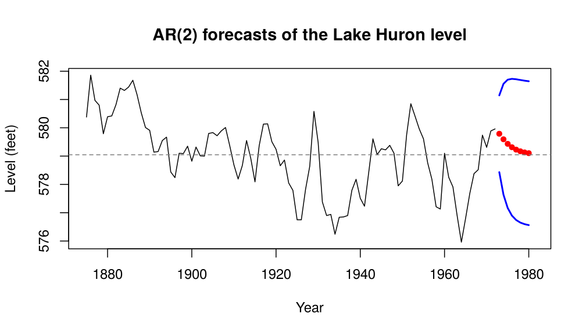

*Figure 4.10. Lake Huron levels with AR(2) forecasts for 1973-1980 (red) and approximate 95% prediction intervals (blue).*

- Red points: point forecasts.
- Blue lines: $\pm 1.96$ standard errors (approximate 95% prediction intervals).
- Dashed line: the estimated mean $\hat\mu$.

We can check the formulas by hand. The one-step forecast uses the last two
observations, and the standard errors come from the $\psi$ weights:


```r
n <- length(LakeHuron)
mu_hat + phi_hat[1] * (LakeHuron[n] - mu_hat) +
  phi_hat[2] * (LakeHuron[n - 1] - mu_hat)   # one-step forecast
```

```
#> [1] 579.7896
```

```r
huron_pred$pred[1]
```

```
#> [1] 579.7896
```

```r
psi <- c(1, ARMAtoMA(ar = phi_hat, lag.max = 7))     # psi_0, ..., psi_7
round(rbind(by_hand = sqrt(fit_ar2$sigma2 * cumsum(psi^2)),
            predict = as.numeric(huron_pred$se)), 4)
```

```
#>          [,1]   [,2]   [,3]   [,4]   [,5]   [,6]  [,7]   [,8]
#> by_hand 0.692 1.0002 1.1567 1.2327 1.2686 1.2853 1.293 1.2965
#> predict 0.692 1.0002 1.1567 1.2327 1.2686 1.2853 1.293 1.2965
```

The forecasts move from the last observation
($579.96$ feet in 1972) back towards the mean
$\hat\mu = 579.05$, and the intervals widen with the horizon. The
standard error grows from $0.692$ at $h = 1$ to
$1.297$ at $h = 8$, approaching the fitted
unconditional standard deviation
$\sqrt{\hat\gamma_0} = 1.299$.

## 7. Summary and transition to ARMA models

- AR models describe a process whose current value depends on a finite number
  of its past values plus a new white noise term.
- Stationarity holds when all roots of the characteristic polynomial
  $\phi(z)$ lie outside the unit circle; for AR(1) this is $|\phi_1| < 1$, for
  AR(2) the triangle of Section 3.1.
- The ACF and PACF are diagnostic fingerprints: AR processes have a gradually
  decaying ACF and a PACF that cuts off after lag $p$.
- The Yule–Walker equations link the parameters to the autocorrelation
  structure.
- Forecasts are computed recursively; they revert to the mean, and their
  error variance grows with the horizon towards the unconditional variance
  $\gamma_0$, so the prediction intervals widen.
- Identification, estimation, diagnostic checking and comparison of models
  form an iterative cycle, developed in full as the Box–Jenkins method in
  Chapter 7.

In the next chapter we combine both mechanisms, dependence on past values (AR)
and on past white noise terms (MA), to form the **ARMA($p$, $q$)** model, a flexible and
widely used framework for stationary time series.

## Chapter checkpoint

Before moving on, make sure you can answer these questions in words.

1. What does an AR model use to predict the present?
2. How does $\phi_1$ affect persistence in an AR(1) model?
3. Why does the ACF of an AR model usually tail off?
4. What extra information does the PACF give beyond the ACF?

Try this: compare two AR(1) models, one with $\phi_1 = 0.2$ and one
with $\phi_1 = 0.9$. Predict which series will forget the past faster, then
check your prediction with simulated series and their ACF plots.


<!-- SHORT_ANSWER: GitHub and website only, not in the PDF -->
<details>
<summary>Show answer</summary>

1. Its own past values:
   $X_t = \phi_1X_{t-1} + \dots + \phi_pX_{t-p} + \epsilon_t$.
2. $\rho_h = \phi_1^h$: the larger $|\phi_1|$, the longer the memory and the
   longer the swings away from the mean ($\phi_1 < 0$ gives alternating signs).
3. $\rho_h = \phi_1\rho_{h-1} + \dots + \phi_p\rho_{h-p}$, so the ACF decays
   geometrically or as a damped sine wave, but does not cut off.
4. The PACF measures the direct dependence of $X_t$ on $X_{t-h}$ after the
   intermediate lags are removed. For an AR($p$) it cuts off after lag $p$,
   which gives the order.

Try this: $\phi_1 = 0.2$ forgets faster ($0.2^2 = 0.04$, while
$0.9^5 \approx 0.59$). The $\phi_1 = 0.9$ series shows long swings and a slowly
decaying sample ACF.

</details>

## Modern time-series thread 4: From AR recursion to LSTM memory

An autoregressive model carries information forward through observed lagged
values. A recurrent neural network (RNN) carries information through a learned
**hidden state**. The Long Short-Term Memory model (LSTM) extends the RNN by
learning when information should be written, retained and exposed.

### From a linear state to a nonlinear state

For an AR(1) process with mean $\mu = c/(1 - \phi)$,

```math
X_t = c + \phi X_{t-1} + \epsilon_t .
```

Since the future white noise terms average out, the influence of $X_t$ on
$X_{t+h}$ is proportional to $\phi^h$: for iid white noise,
$\text{E}(X_{t+h} \mid X_t) - \mu = \phi^h(X_t - \mu)$. This is a
fixed geometric memory decay.

A simple RNN instead updates a hidden state:

```math
\mathbf{h}_t = \tanh(\mathbf{W}_xX_t + \mathbf{W}_h\mathbf{h}_{t-1} + \mathbf{b}),
\qquad
\hat X_t(1) = \mathbf{w}_y^\top\mathbf{h}_t + b_y .
```

The hidden state can represent nonlinear combinations of the current
observation and earlier information. However, ordinary RNNs often struggle to
preserve information over long sequences.

### LSTM model

An LSTM maintains a cell state $\mathbf{c}_t$ and uses gates with values
between zero and one. Here $\sigma(u) = 1/(1 + e^{-u})$ is the logistic
function applied elementwise (not a standard deviation), and $\odot$ is the
elementwise product:

```math
\begin{aligned}
\mathbf{f}_t &= \sigma(\mathbf{W}_fX_t + \mathbf{U}_f\mathbf{h}_{t-1} + \mathbf{b}_f), \\
\mathbf{i}_t &= \sigma(\mathbf{W}_iX_t + \mathbf{U}_i\mathbf{h}_{t-1} + \mathbf{b}_i), \\
\tilde{\mathbf{c}}_t &= \tanh(\mathbf{W}_cX_t + \mathbf{U}_c\mathbf{h}_{t-1} + \mathbf{b}_c), \\
\mathbf{c}_t &= \mathbf{f}_t\odot\mathbf{c}_{t-1} + \mathbf{i}_t\odot\tilde{\mathbf{c}}_t, \\
\mathbf{o}_t &= \sigma(\mathbf{W}_oX_t + \mathbf{U}_o\mathbf{h}_{t-1} + \mathbf{b}_o), \\
\mathbf{h}_t &= \mathbf{o}_t\odot\tanh(\mathbf{c}_t).
\end{aligned}
```

Interpret the gates as controls:

- The **forget gate** $\mathbf{f}_t$ controls how much previous memory remains.
- The **input gate** $\mathbf{i}_t$ controls how much new candidate information
  is written.
- The **output gate** $\mathbf{o}_t$ controls how much cell information becomes
  visible to the next layer.

Unlike an AR coefficient, these gate values can change with the current input
and hidden state. This lets an LSTM retain a useful signal during a quiet
interval and revise its memory after a major event.

### Use case: traffic demand with irregular long memory

Recent traffic volume is important, but demand may also depend on a sporting
event announced hours earlier, the day of the week, the weather, and
interactions among these inputs. An AR model represents a fixed linear lag
relationship. An LSTM can learn a nonlinear state whose effective memory
changes with context.

This flexibility has a cost: an LSTM usually needs more data, more tuning and a
carefully designed temporal validation set. Its fitted mechanism is also less
transparent than a small AR model.

**Activity: How long does memory survive?** First
compare the theoretical memory weights of two AR(1) models. Then compare them
with a simplified LSTM cell whose forget gate stays at $f = 0.95$ and which
receives no new input after time zero.


```r
h <- 0:30
memory <- cbind(
  AR_phi_0.50 = 0.50^h,
  AR_phi_0.90 = 0.90^h,
  LSTM_f_0.95 = 0.95^h
)

matplot(h, memory, type = "l", lty = 1, lwd = 2,
        main = "Geometric memory under fixed retention",
        xlab = "Steps after the event", ylab = "Relative influence")
legend("topright", col = 1:3, lty = 1, lwd = 2,
       legend = colnames(memory), cex = 0.8)
```

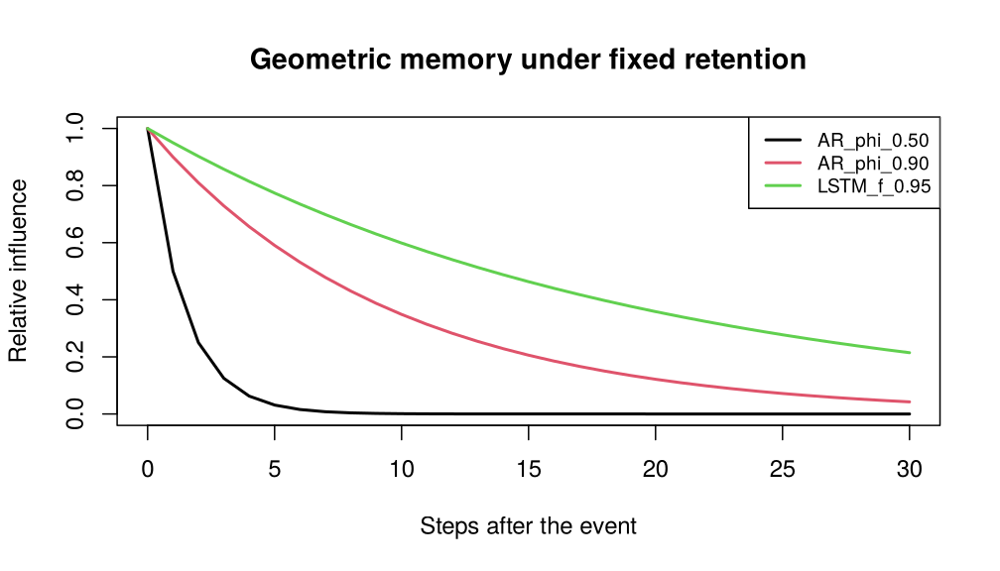

*Figure 4.11. Relative influence of an event after h steps: AR(1) with phi = 0.5 and 0.9, and fixed LSTM retention f = 0.95.*

```r
round(memory[c(1, 6, 11, 21, 31), ], 3)   # h = 0, 5, 10, 20, 30
```

```
#>      AR_phi_0.50 AR_phi_0.90 LSTM_f_0.95
#> [1,]       1.000       1.000       1.000
#> [2,]       0.031       0.590       0.774
#> [3,]       0.001       0.349       0.599
#> [4,]       0.000       0.122       0.358
#> [5,]       0.000       0.042       0.215
```

Now consider two contexts for the same trained LSTM:

- During normal operation, the forget gate is near $0.95$.
- Immediately after a machine reset, the forget gate falls to about $0.10$.

Explain how this input-dependent change differs from fitting two separate AR(1)
coefficients. Identify one situation where the adaptive memory is helpful and
one where the simpler AR model should be preferred.


<!-- SHORT_ANSWER: GitHub and website only, not in the PDF -->
<details>
<summary>Show answer</summary>

At $h = 10$ the weights are about $0.001$ ($\phi = 0.5$), $0.349$
($\phi = 0.9$) and $0.599$ ($f = 0.95$). Two AR(1) fits need the regimes to be
known and split by hand. The LSTM forget gate depends on the input, so one
model detects the reset and changes its memory itself. Adaptive memory helps
when such events are frequent and recognisable from the data (machine resets).
The AR model is preferable when the relation is linear and stable, data are
few (98 Lake Huron values), or interpretability and reliable prediction
intervals matter.

</details>

*Source:* M. Wu et al. (eds), *AI for Time Series, Volume 1*, CRC Press, 2026, Chapter 5, "Unlocking the Power of LSTM for Long-Term Time Series Forecasting" (Zepu Wang, Yaxuan Kong and Yuqi Nie).
